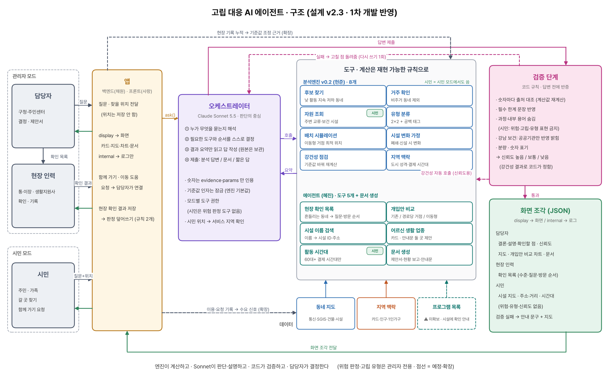

# 에이전트 설계 v2.3 (팀 통합안 · 분석엔진 v0.2 · 에이전트 1차 개발 반영)

2026-10-09 · 에이전트 1차 개발에서 바뀐 부분 반영 (구현은 [`../README.md`](../README.md), 변경 요약은 10절)

2026-10-08 · v2.1(10/1)을 팀 자료 5종(사랑·채원·혜진·현준 PDF, 5차 회의록)과 분석엔진 v0.2(10/3 문구·폰트 수정 포함)에 다시 대조해 **구현 수단이 비어 있던 부분**을 보완 (변경 요약은 맨 아래 10절)

## 한 줄 정의

**고립 위험 동네를 찾아 "사람을 시설로 연결할지 · 서비스를 동네로 보낼지"를 계산해 담당자에게 제안하고, 시민에게는 갈 곳을 쉽게 보여주고 혼자 가기 어려우면 이웃과 이어주는 AI 에이전트**

- 단위: 위험 판단은 개인이 아니라 **동네(250m)** — 집계 데이터라 "누구"가 아니라 "어느 동네"를 짚는다
- 최종 수혜자는 **주민**, 에이전트는 한정된 복지 인력이 가장 필요한 곳에 먼저 가도록 돕는다
- 최종 결정: 항상 담당자

## 0. 두 가지 모드

| 모드 | 사용자 | 목적 | 응답 형태 |
| --- | --- | --- | --- |
| **관리자 모드** | 담당자 (구청·주민센터) | 어디에, 무엇을 할지 **결정**하고 **산출물** 작성 | 지도 · 시나리오 비교 차트 · 실행안 카드 · **제안서·보고서 문서** |
| | 현장 인력 (통·이장, 생활지원사, 방문간호사) | 동네를 **확인**하고 결과를 **기록** | 모바일 현장 확인 체크리스트 |
| **시민 모드** | 주민 · 가족 | 갈 곳을 **쉽게 찾고**, 혼자 어려우면 **함께 가기** | 지도 · 일정 · 길찾기 · 쉬운 말 · 큰 글씨 · 음성 |

### 관리자 모드 — 결정과 산출물

- 질문하면 지도·차트·카드로 답한다 ("춘천 외곽에 이동형 상담 2곳, 어디가 좋아?")
- 담당자가 실제로 내야 하는 **산출물을 바로 만든다**
  - 사업 제안서·계획(안): 추진 배경, 대상 지역, 근거 데이터, 운영안, 기대 효과(접근성 개선)
  - 주간·월간 현황 보고 — 1차 개발은 **현 시점 현황**만 정리한다. 지난 보고와 비교하려면 현장 확인 기록이 쌓여야 한다
  - 주민 안내문 (이장 방송·문자·게시물용)
- 현장 인력 화면: 에이전트가 뽑은 확인 목록을 방문 순서대로 보여주고, 동네마다 **불확실한 점만 골라** 묻는다 (예: 밤 체류는 있는데 건물이 0채 → "실제로 사는 집이 있나요?"). 기록 중 두 가지 답(사람이 사는 집 없음, 지원 불필요)은 백엔드가 동네 판정에 바로 반영하고, 나머지는 쌓아서 기준 보정 근거로 쓴다 (`engine/현장기록_규격.md`)

### 시민 모드 — 찾기 쉽게, 혼자 두지 않게

- **찾기**: "집 근처에 어머니가 다니실 만한 모임 있어요?" → 지도에 가까운 시설·주소·거리, 어르신 활동이 많은 시간대, 길찾기 버튼
  - 찾는 위치는 앱이 넘겨준다: 지금 있는 곳(위치 허용) 또는 지도·주소로 고른 곳 — 다른 지역의 가족이 대신 찾는 경우를 포함한다
  - 서비스 지역(강남구·춘천시) 밖이거나 위치가 없으면 안내 문구만 보여준다
  - ⚠ 시설 프로그램·운영 시간·전화번호 데이터가 없어 "시설에 직접 확인해 보세요"로 안내한다 (10절 남은 과제 1)
- **함께 가기**: 찾았는데 **멀거나 혼자 하기 어려우면** 화면에서 바로 요청한다
  - "함께 갈 이웃 찾기" → 같은 날 같은 곳에 가려는 신청자를 묶어 **담당자가 연결**한다
  - "이동 도움 요청" → 담당자에게 전달되어 이동 지원·동행을 연계한다
- **접근성**: 큰 글씨, 읽어주기(음성), 음성 질문, 쉬운 말, 가족이 대신 찾아보고 공유
- **이용 기록은 수요 신호가 된다**: 어느 동네에서 어떤 프로그램을 찾는지, 어디서 함께 가기 요청이 많은지를 익명 집계해 관리자 모드의 판단 근거로 쓴다 → 매달 쌓이는 **우리만의 데이터**

**시민 모드 원칙**
- 위험 판정은 **보여주지 않는다** — "이 동네는 고립 위험"이 아니라 "이런 곳이 있어요"만 안내 (낙인 방지)
- 개인 정보는 저장하지 않는다 — 요청 시 연락처만 담당자에게 전달. 찾는 위치 좌표도 Sonnet 에 넘기지 않고 로그에서 가린다
- 앱을 못 쓰는 분은 관리자 모드의 **안내문·현장 인력**을 통해 같은 정보를 받는다 (주민 안내문은 관리자 모드에서 만들지만 시민 기준 표현 규칙을 따른다)

## 0-1. 고립 유형 (관리자 전용)

5차 회의에서 정하고 분석엔진 v0.2가 계산하는 2×2 유형이다. **시민 모드에는 보이지 않고, 개인 단위 분류는 하지 않는다.**

| | 자원 가까움 | 자원 멂 (공백) |
| --- | --- | --- |
| **활동 위축 O** | **연계형** (우선 2) — 자원은 있는데 이용 저조 → 동행·프로그램 연결 | **긴급방문형** (우선 1) — 위축과 공백이 겹침 → 방문 안부·이동형 상담 |
| **활동 위축 X** | **관찰형** (우선 4) — 정기 모니터링 | **예방인프라형** (우선 3) — 지금은 괜찮으나 구조적으로 취약 → 이동형·공공시설 개방 검토 |

**판정 기준 (엔진 `config.py`)**

| 항목 | 기준 |
| --- | --- |
| 거주 칸 | 야간 비중(강남 0.07·춘천 0.03) AND SGIS 1km 주택 수(강남 200·춘천 30)를 한 달이라도 통과 AND GIS 주거·용도미상 건물 ≥ 1 |
| 활동 위축 | 거주 & 고령 상위 25% & 낮 활동 robust z < 0 인 달이 6개월 중 4개월 이상 |
| 자원 멂 | 교류시설(경로당·마을회관·도서관·공공체육·문화) **500m 초과** 또는 보건기관 **3km 초과** |
| 공백 태그 | 무엇이 먼지: `교류` / `보건` / `둘다` → 긴급방문형 안에서 처방을 나눈다 |
| 예방인프라형 | 위축 없음 + 공백 + **어르신 비중 상위 25% 칸**만 (미달 칸은 공백이어도 관찰형) |

**두 층으로 나눠 말한다**
- **위축 신호 층** (정책 우선 대상): 긴급방문형 · 연계형
- **자원 구조 층** (위축 신호 없음): 예방인프라형 · 관찰형
- 두 층을 합쳐 "위험 동네 N곳"처럼 말하지 않는다

**현재 결과 (엔진 v0.2 기본값)**

| | 위축 후보 | 연계형 | 긴급방문형 | 예방인프라형 | 관찰형 |
| --- | --- | --- | --- | --- | --- |
| 강남 | 51 | 38 | 13 (전부 보건 공백) | 22 | 453 |
| 춘천 | 153 | 98 | 55 (교류 38 · 보건 12 · 둘다 5) | 101 | 1,361 |

- 위축 후보는 팀 EDA 257칸(강남 65 · 춘천 192)에서 **주거건물이 없는 칸을 뺀 204칸**이다
- ⚠ 강남 긴급방문형 13칸은 전부 **보건 공백**인데, 강남 보건 데이터가 공공 보건기관 3곳뿐이라 생긴 결과다 (민간 의원 미포함). 발표에서 강조하려면 병의원 데이터 추가 여부를 정해야 한다

**5차 회의 "고립 유형 4가지"와의 대응**

| 5차 회의 (위축 동네) | 엔진 표현 |
| --- | --- |
| 위축 + 교류·보건 모두 가까움 → 갈 곳은 있는데 안 감 | 연계형 |
| 위축 + 교류 공간 멂 → 만날 곳이 없음 | 긴급방문형 · `교류` 태그 |
| 위축 + 보건기관 멂 → 건강 시설이 없음 | 긴급방문형 · `보건` 태그 |
| 위축 + 둘 다 멂 → 모든 게 멂 | 긴급방문형 · `둘다` 태그 |

위축 신호가 없는 동네는 예방인프라형(공백 + 어르신 많음) / 관찰형으로 따로 둔다.

**지역 맥락은 유형을 읽는 방식에만 쓴다** (지역 단위, 격자에 곱하지 않음)
- 춘천: 고령 외출 감소형 맥락 → 연계형은 건강·경로당 프로그램, 긴급방문형은 이동형 건강상담
- 강남: 관계 단절 **가능성**(청년·중장년 1인가구 구조, 카드 신호는 미검증) → 연계형은 소모임·관계 형성 프로그램. 관찰형도 "신호 없음 ≠ 고립 없음"

## 1. 팀 자료에서 가져온 것

| 자료 | 핵심 기여 | 통합안에서 |
| --- | --- | --- |
| 사랑 (0930 회의 준비) | 고립 2유형(활동 위축 / 관계 부재), 에이전트 도구 목록(후보 조회·집단 프로파일·주변 자원·임계값 재계산·브리프), 카드 = 해석 맥락 | 도구 구조, 확장 레이어 |
| 채원 (생활권 단절 회복 에이전트) | A~D 접근성 유형, **개입 시나리오 시뮬레이션**, "사람을 기관으로 vs 기관을 지역으로", 검증된 프로그램 목록에서 추천 | **핵심 차별점 ①** |
| 혜진 (EDA 통합·에이전트 v1) | 위축 × 공백 두 축 분리, 함정 규칙 기반 검증, 피드백 루프 | **핵심 차별점 ②** |
| 현준 (09/30) | 질문에 따라 계산 순서를 바꾸는 대화형 비서, ⓪ 도시 파악, 건물로 거주 확인, 카드 생활 시간대, 유사 서비스 비교 | 오케스트레이터 구조, **차별점 ③** |
| 5차 회의록 (09/30) | 멀티모달 응답, 관리자/사용자 모드, 고립 유형 4가지·관리자만 열람, 혼자 어려우면 담당자 연결 → 주민 연계 | 두 모드, 0-1절, 차별점 ⑤⑥ |

**팀 자료가 이미 합의한 것**
- 통신 = 어디, 카드 = 도시 성격·생활 패턴 (격자로 내리지 않음)
- 강남과 춘천은 다르게 판단한다
- 숫자 계산은 재현 가능한 규칙으로, LLM은 판단 순서 결정과 설명
- 후보 동네는 "고립 확정"이 아니라 "우선 확인 대상"

## 2. 왜 지금은 차별성이 약한가

지금까지의 설계는 모두 **탐지 → 분류 → 추천** 구조다.
이건 영국 Age UK 고립 지도, 서울시 통신데이터 분석, 다른 팀이 흔히 만들 "위험 지도 + 챗봇"과 뼈대가 같다.

> 차별성은 **탐지 이후**에서 나와야 한다.
> "어디가 위험하다"는 누구나 말한다. 우리는 **"그래서 무엇을, 어디에, 얼마나 효과 있게"** 까지 계산한다.

## 3. 차별화 포인트

### ① 처방을 계산한다 — 개입 시뮬레이션

위험 동네마다 개입 방식을 **비교**하고 효과를 **숫자로** 보여준다.

- 선택지: 기존 시설 연결 / 경로당 거점 프로그램 / 이동형 서비스 배치
- 배치 시뮬레이션: "이동형 상담 2곳을 운영하면 어디에 둘 때 위축 후보 동네를 가장 많이 커버하나"
- 시설 변화 가정: "이 경로당이 문을 닫으면 공백이 어디서 생기나"
- 결과: 긴급방문형 중 이동형 반경 안에 들어오는 칸 수와 60대+ 유동 커버 비율, 거점 수(k=1~5)별 커버 곡선

**세 가지 개입안을 같은 기준으로 비교하는 방법** (에이전트가 엔진 도구를 조합)

| 개입안 | 계산 방법 |
| --- | --- |
| 기존 시설 안내 | `classify` 기본 결과 그대로 (변화 없음 = 기준선) |
| 경로당 거점 프로그램 | `facility_change`로 **이동형 거점마다 가장 가까운 경로당**(같은 수·같은 동네)에 보건 기능(`kind=보건`)을 추가 |
| 이동형 서비스 배치 | `simulate_placement` |

- 공통 비교 지표: **긴급방문형 중 해소되는 칸 수** (이동형 도달 또는 다른 유형으로 바뀌는 칸)
- 월 운영 횟수 같은 이용량은 가정하지 않는다 (접근성만 계산)
- 엔진 v0.2 예시: 강남은 반경 1km 거점 2곳이면 100%. 춘천은 반경 1km로 3곳 48%·5곳 62%, 반경 3km(차량)로 3곳 73%·5곳 90%
- 1차 개발 결과 (`compare_interventions`, 비교 막대그래프 포함): 춘천 거점 3곳·반경 1km에서 긴급방문형 55곳 중 경로당 거점 9곳 vs 이동형 16곳 해소 (춘천 긴급방문형은 교류 공백이 많아 보건 기능만 더해서는 일부만 해소). 강남 2곳은 13곳 vs 13곳으로 같아(전부 보건 공백) 상설 거점과 순회 방식의 운영 차이로 설명한다

> "고립이 몇 % 준다"는 단정하지 않는다. **접근성이 얼마나 개선되는지**만 계산한다.

근거: 위축 동네가 오히려 자원에 더 가깝다 (춘천 539m vs 831m) → 같은 "위험"이라도 **연결형과 방문형이 갈린다**.

### ② 스스로 반증하고 신뢰도를 말한다

답변을 내보내기 전에 검증 단계(코드 규칙, `verifier.py`)가 EDA에서 실제로 겪은 함정을 확인한다.

규칙은 **실제 도구 출력에 대고 확인할 수 있는 것**으로 정한다.

| 규칙 | 확인 내용 | 1차 개발 |
| --- | --- | --- |
| 숫자 대조 | 화면 문장의 모든 숫자에 출처(`evidence`·`params`)가 있고 값이 맞는가. 계산값은 다시 계산 | ✅ |
| 한계 문장 | 질문에 쓴 도구에 따라 반드시 반영할 `caveats`가 들어갔는가 (예: 유동인구 ≠ 거주자, 두 층 구분, 접근성만 비교) | ✅ |
| 기준값 민감도 | 기준(주택 수·거리·위축 개월)을 바꿔도 결과가 유지되는가 → 신뢰도 등급 | ✅ |
| 강남 보건 공백 | 강남 결과에는 "공공 보건기관만 반영"을 밝히고 단정하지 않는다 | ✅ (필수 한계) |
| 과정 숨김 (추가) | 도구·지표 이름, 기준값, 기준을 바꾼 결과 수치를 화면 문장에 쓰지 않는다. 시민 화면은 위험·고립·유형 표현도 금지 | ✅ |
| 분량·가독성 (추가) | 설명 300자·문단 3개 이상, 긴 문장은 나누도록 경고 | ✅ |
| 강남 고령 과대추정 | 강남 유동 고령 비중은 실제 거주보다 높게 잡힌다 | 미적용 (엔진 caveat "유동 ≠ 거주"로 대신) |
| 관광 착시 | 춘천 7~10월 고령 비중 변화는 관광객 유출입 때문일 수 있다 | 미적용 (월별 해석 답변 없음) |
| 로컬 결제 해석 | 로컬 결제 비율을 생활 반경·고립 신호로 말하지 않는다 | ✅ (인용하면 필수 한계. 도시 성격 구분에만 사용, 시민 모드·주민 안내문에는 쓰지 않음) |

카드 일간 지수를 쓰지 않기로 해서, v2.1의 "명절 주간"·"소표본·마스킹" 규칙은 카드 해석이 들어가는 답변에서만 보조로 쓴다.

- 관리자 답변에 **신뢰도 등급**을 붙인다. 화면 표시는 **높음 / 보통 / 낮음** (v2.2의 확정 / 관찰 / 보류)
  - 코드가 정한다: 기준을 하나씩 바꿔도 긴급방문형 판정이 70% 이상 겹치면 높음, 아니면 보통, 검증 실패면 낮음. 현재 춘천·강남 모두 보통
  - **뒤집힐 조건은 숫자 없이** 현장에서 확인할 점으로 쓴다 (예: "실제로 사람이 사는 집인지 확인이 필요합니다"). 기준값과 바꾼 결과 수치는 사용자 화면에 보이지 않는다
  - 시민 화면에는 신뢰도를 보여주지 않는다
- 검증에 실패하면 고칠 점을 돌려 한 번 다시 쓰게 하고, 그래도 실패하면 검증 안 된 문장은 숨기고 안내 문구와 지도만 보여준다 (그릴 결과가 없으면 안내 문구만)
- 근거: 필터 하나로 결론 부호가 뒤집힌 경험 (50m → 250m 전환)

### ③ 도시 성격에 따라 추론 경로를 바꾼다

같은 질문도 도시마다 다르게 푼다.

| | 강남 (방문 도시) | 춘천 (주민 생활권) |
| --- | --- | --- |
| 판단 근거 | 지역 가맹점 결제 중 지역민 40% (외지인 60%) | 지역 가맹점 결제 중 지역민 82% |
| 위험 분포 | 노후 주거 × 고령이 특정 지점에 모임 (ρ 0.56) | 외곽 전역에 흩어짐 |
| 자원 구조 | 고령 밀집지는 민간이 빠지고 공공만 남음 | 격자 86.8%가 300m 내 자원 없음 |
| 기본 처방 | **연결형** · 공공 프로그램 거점 · 지점 타겟 | **방문형** · 이동형 · 보건진료소·마을회관 거점 |

**1차 개발 구현**: 도시 성격은 엔진 지역 맥락(`region_context`)의 로컬 결제 비율(`local_payment_pct`, 지역 가게 결제 중 같은 시·도 주민 결제 비중 — 강남 39.9%, 춘천 82.2%)로 밝힌다. 엔진 caveat 이 이 값을 "도시 성격(강남 방문 도시 / 춘천 주민 생활권) 구분에만" 쓰도록 정해 두었다 (분석엔진 10/3 수정).
- 관리자 답변("어디부터"·배치·개입안 비교·제안서)은 지역 맥락을 함께 불러 도시 성격을 한두 문장으로 밝히고, 결과가 보여주는 도움 방식이 왜 이 도시에 맞는지 잇는다. 결론(어디·무엇)은 엔진 결과가 정하고, 도시 성격은 설명을 거든다
- 이 값을 인용하면 "생활 반경·고립 신호로 해석하지 않는다"는 한계를 반드시 반영한다 (검증 규칙, 차별점 ②). "주민이 동네 안에서 생활한다"처럼 바꿔 말하지 않고 "지역 가게를 누가 이용하는지"로만 말한다. 주민 안내문·시민 모드에는 쓰지 않는다
- 엔진 결과에서도 도시별 차이가 드러난다. 강남은 공백이 보건기관 쪽에 몰려(공공 보건기관만 반영) 개입안 비교에서 경로당 거점과 이동형의 해소 수가 같고, 춘천은 교류시설 공백이 많아 이동형이 더 많은 동네에 닿는다
- 엔진 지역 맥락의 도시 해석 관점(`lens`)은 춘천 "활동 위축형", 강남 "관계 부재형 가능성"으로 이 표와 관점이 다르다. 도시 성격은 `lens`가 아니라 로컬 결제 비율로 말한다

### ④ 현장 확인을 설계한다

- 기준을 바꾸면 판정이 뒤집히는 **불확실한 동네**를 "현장 확인 목록"으로 따로 뽑는다
  - **칸별 안정도는 에이전트에서 구현한다.** 엔진 내부 함수(`_universe`)를 기준값 조합마다 불러 각 동네가 긴급방문형으로 판정되는 비율을 센다 (춘천 108개 조합 0.9초, 10/8 확인)
  - 안정도는 **현실적인 범위**에서 계산한다. 1차 개발: 엔진 기본값의 ±20%(교류 400·500·600m, 보건 2.4·3.0·3.6km, 주택 춘천 24·30·36호 / 강남 160·200·240호)와 위축 개월 4·5 → 54개 조합, 춘천 1초 이내. 극단값까지 섞으면 춘천 긴급방문형 55칸 중 80% 이상 유지되는 칸이 0개라 목록이 쓸모없어진다. 극단값 범위는 `robustness`로 결과 전체의 민감도를 보여주는 데만 쓴다
  - 내부 함수는 엔진의 공개 약속이 아니므로, 현준에게 유지를 부탁하거나 `robustness`에 칸별 안정도 **선택 필드**를 추가해 달라고 한다 (선택 사항)
  - 확인 수준: 판정 유지 80% 이상은 안정(목록 제외), 50~80% **확인 필요**, 50% 미만 **꼭 확인**. 결과: 춘천 긴급방문형 55곳 → 안정 21 · 확인 필요 20 · 꼭 확인 14, 강남 13곳 → 1 · 9 · 3
  - 확인 질문은 기준 하나만 바꿨을 때 판정이 바뀌는 기준에 맞춰 만든다: 주택 기준 → "실제로 사람이 사는 집이 있나요?", 교류 거리 → "가까운 경로당·마을회관까지 실제로 걸어가기 어려운가요?", 보건 거리 → "보건소·보건진료소까지 실제로 가기 어려운가요?", 위축 기간 → "낮에 어르신이 밖에 나오시나요?", 여러 기준이 겹칠 때만 바뀜 → "동네 상황을 전반적으로 확인해 주세요."
  - 방문 순서: 확인할 동네가 많은 행정동부터 묶고, 같은 동 안에서 꼭 확인 → 확인 필요 순. 화면에는 확인 수준·질문·순서만 보이고 안정도 숫자는 보이지 않는다
  - 현장 결과 반영: MVP는 백엔드가 해당 동네 판정을 덮어쓴다. 기준값 자동 조정은 확장
- 동네마다 **무엇이 불확실한지**에 맞춰 확인 질문을 만든다
- **현장 인력**이 모바일로 확인·기록하면 진단 기준(위축 기준, 거주 기준)을 보정한다
- 데이터가 부족한 부분을 **현장이 채우는 구조** — 춘천 주택 기준값(0~200호) 논쟁을 현장 데이터로 해결하는 경로

### ⑤ 찾아주는 데서 끝내지 않고 이어준다

- 기존 서비스는 "근처 기관 목록"을 주고 끝난다. 하지만 고립된 사람은 **알아도 혼자 가지 못한다**
- 시민 모드에서 "함께 갈 이웃 찾기 · 이동 도움 요청"을 누르면 담당자가 **같은 곳에 가는 주민끼리** 연결한다
- 이 요청 기록 자체가 "어디에 이동 지원이 필요한가"라는 **새 데이터**가 되어 관리자 모드의 배치 시뮬레이션에 다시 들어간다

### ⑥ 텍스트가 아니라 보이는 답을 준다 — 멀티모달 응답

일반 LLM 챗봇은 긴 글로 답한다. 우리 에이전트는 **질문과 사용자에 맞춰 응답 형식을 고른다.**

| 사용자 | 응답 구성 |
| --- | --- |
| 담당자 | 위험 동네 **지도**, 개입안 **비교 차트**, **실행안 카드**, 바로 제출할 **제안서 문서** |
| 현장 인력 | 방문 **목록**, 버튼으로 답하는 **체크리스트** |
| 시민 | 갈 곳 **지도**, 길찾기·함께 가기 **버튼**, **쉬운 말 요약**, **음성**으로 읽어주기 (일정표·전화는 프로그램·연락처 데이터 확보 후) |

- 오케스트레이터가 계산 결과를 "화면 조각(지도·차트·카드·문서)"으로 구성한다
  - 화면 조각은 **사용자에게 보이는 부분**(결론·설명·확인할 점·신뢰도·지도·차트·문서)과 **내부 기록**(숫자 출처·검증 결과·도구 호출 순서)으로 나뉜다. 프론트는 보이는 부분만 그린다
  - 사용자에게는 **결론과 설명만** 쉬운 말로 준다. 분석 과정(도구·지표 이름, 기준값, 계산 과정)은 보여주지 않는다
  - 설명은 짧게 끝내지 않는다. 정보량은 유지하고 긴 문장은 여러 짧은 문장으로 나눈다 (관리자·시민 공통)
  - 유형 이름은 쉬운 이름을 함께 쓴다: 긴급방문형 = 가장 먼저 방문이 필요한 동네, 연계형 = 가까운 시설과 이어 주면 좋은 동네, 예방인프라형 = 미리 시설을 갖춰 두면 좋은 동네, 관찰형 = 정기적으로 살펴보면 되는 동네 (시민 화면에는 둘 다 쓰지 않는다)
  - 답변에서 언급한 장소는 지도에서 강조한다. 문서는 Markdown 으로 내보낸다

## 4. 구조

**오케스트레이터(LLM) + 도구 + 검증 단계(코드 규칙)**

- **오케스트레이터 (Claude Sonnet)**: 누가 무엇을 묻는지 해석하고, 도시 성격을 파악하고, 필요한 도구와 순서를 스스로 정하고, 사용자에 맞는 형식(지도·차트·카드·문서·음성)으로 응답을 구성한다
- **도구**: 계산은 모두 재현 가능한 규칙. 8개는 **분석엔진**(현준), 나머지는 에이전트·백엔드 (아래 표)
- **검증 단계**: 답변 초안을 코드 규칙으로 확인하고 신뢰도를 붙인다. 실패하면 고칠 점을 돌려 다시 쓰게 한다 (차별점 ②)

**분석엔진과 에이전트의 역할 분담**
- 엔진 = 계산기: 같은 입력이면 항상 같은 결과. 모든 도구가 `result / evidence / caveats / params` 같은 형식으로 돌려준다
- Sonnet은 **숫자를 직접 만들지 않는다.** 엔진의 `evidence` 숫자만 인용하고, 검증 단계가 답변 숫자와 `evidence`를 대조한다
- 엔진 전체 결과는 에이전트가 질문 동안 보관하고(`r1`, `r2` …), Sonnet에게는 `evidence`와 핵심 값만 요약해 넘긴다 (강건성 점검 전체 결과는 약 10만 자라 그대로 넣지 않음). 지도 점·차트 숫자는 에이전트가 보관한 원본에서 코드로 꺼내 화면 조각(`display`)에 담고, 프론트는 그것을 그린다. 백엔드는 화면 조각의 내부 기록(`internal`)을 로그로 저장한다
- 기준값(위축 개월, 주거 필터, 교류·보건 거리)은 도구 스키마에서 빼서 LLM이 마음대로 바꾸지 못하게 한다
- 엔진 공개 도구만 호출한다. 예외: 칸별 안정도(`_universe`), 시설 이름 검색(엔진 시설 데이터 파일 읽기), 어르신 생활 업종(팀 EDA 결과표 읽기)

**모드별 도구 권한**
- 관리자 모드: 전체 도구
- 시민 모드: 자원 조회 · 시간대(`senior_hours`)만. 후보 찾기·유형 분류는 **도구 목록에서 아예 빼고 실행 단계에서도 거절한다** → 위험 판정이 구조적으로 나올 수 없다
  - 지역 맥락(`region_context`)은 결과에 유형별 칸 수가 들어 있어 시민 모드에서 빼고, 60대 이상 결제 시간대만 꺼내는 `senior_hours`를 대신 준다
  - 이웃 연결은 백엔드, 프로그램 검색은 데이터 확보 전이라 에이전트 도구가 아니다

| 도구 | 담당 | 엔진 함수 | 하는 일 |
| --- | --- | --- | --- |
| 후보 찾기 | 엔진 | `find_candidates` | 낮 활동이 여러 달 계속 낮은 고령 거주 칸 |
| 거주 확인 | 엔진 | `check_residential` | 주거 / 용도미상 / 비주거 / 건물없음 |
| 자원 조회 | 엔진 | `lookup_resources` | 칸 또는 위경도 주변 교류·보건 시설과 거리 (시민 모드도 사용) |
| 유형 분류 | 엔진 | `classify` | 2×2 고립 유형 + 공백 태그 + 칸별 원인·추천 표 (관리자 전용) |
| 배치 시뮬레이션 | 엔진 | `simulate_placement` | 이동형 거점 최적 위치(최대 커버링 정확해) + k=1~5 커버 곡선 |
| 강건성 점검 | 엔진 | `robustness` | 기준값을 바꿔 재계산, 긴급방문형 판정 유지율 |
| 시설 변화 가정 | 엔진 | `facility_change` | 시설 제거·추가 시 유형이 바뀌는 칸 |
| 지역 맥락 | 엔진 | `region_context` | 도시 성격, 60대+ 결제 시간대, 인구·독거 규모 (값 표시만, 계산에 안 씀) |
| 프로그램 검색 | 에이전트 | — | 실제 복지·보건 프로그램 목록에서 검색 (⚠ 목록 데이터 미확보로 미구현 → 10절) |
| 현장 결과 기록 | 백엔드 | — | 방문 결과 저장, 기준 보정 |
| 이웃 연결 | 백엔드 | — | 같은 날·같은 곳에 가려는 신청자 묶기 → 담당자에게 제안 |
| 문서 생성 | 에이전트 | `submit_document` | 제안서·현황 보고·주민 안내문 작성 (Markdown) |
| 짧은 답 | 에이전트 | `submit_brief` | 인사·관계없는 질문·서비스 지역 밖·데이터 없는 질문에 짧게 안내 (숫자 금지, 200자 이내) |
| 시설 이름 검색 | 에이전트 | `find_facility` | 시설 이름 → 시설 ID·주소 (같은 이름은 모두) |
| 현장 확인 목록 | 에이전트 | `field_check` | 칸별 안정도, 확인 수준·질문·방문 순서 (차별점 ④) |
| 개입안 비교 | 에이전트 | `compare_interventions` | 세 개입안 해소 수 비교 (차별점 ①) |
| 시간대 (시민) | 에이전트 | `senior_hours` | `region_context`에서 60대 이상 결제 시간대만 |
| 어르신 생활 업종 | 에이전트 | `senior_industries` | 60대 이상이 자주 쓰는 업종 (카드, 시군구 단위) |

에이전트 쪽 보조 기능: 시민 위치가 서비스 지역 안인지 확인 (위치 → 엔진 칸 ID → 엔진 칸 확인, 칸이 없으면 옆 1칸까지)

## 5. 질문에 따라 달라지는 동작

| 질문 | 에이전트가 쓰는 도구 순서 |
| --- | --- |
| "우리 구에서 어디부터 확인해야 해?" | 후보 찾기 → 유형 분류 → 강건성 점검 + 지역 맥락(도시 성격) |
| "춘천 외곽에 이동형 상담 2곳, 어디가 좋아?" | 후보 찾기 → 배치 시뮬레이션 → 지역 맥락(운영 시간대) |
| "○○경로당이 문을 닫으면?" | 시설 이름 검색 → 시설 변화 가정 |
| "이 동네 결과 믿어도 돼?" | 강건성 점검 → 현장 확인 목록 |
| "현장 확인 목록 만들어 줘" | 현장 확인 목록 |
| "이동형이랑 경로당 거점 중 뭐가 나아?" | 개입안 비교 + 지역 맥락(도시 성격) |
| "이동형 상담 사업 계획서 써줘" | 개입안 비교·배치 시뮬레이션 → 지역 맥락 → 현장 확인 목록 → 어르신 생활 업종 → 문서 생성 |
| (시민) "집 근처 어머니가 다니실 모임 있어요?" | 자원 조회 → 시간대 (프로그램은 시설에 확인하도록 안내) |
| (시민) "함께 갈 이웃 찾기" | 이웃 연결 → 담당자 알림 |

**답변 예시** (1차 개발 실제 출력에서 발췌, `agent/out/examples/5_관리자/03_이동형배치`)
> 이동형 상담 2곳은 사북면과 신북읍에 두는 것이 좋습니다. 두 곳 모두 춘천 외곽에 있고, 가장 먼저 방문이 필요한 동네(긴급방문형)를 가장 많이 덮습니다.
> … 거점 반경 1km에서 2곳을 두면 그중 13곳이 닿습니다. 60대 이상 유동 기준으로는 38%를 덮습니다. 1곳만 두면 19%이고, 3곳이면 48%입니다.
> 다만 이 비율은 상담에 닿을 수 있는 가능성일 뿐입니다. 고립이 줄어드는 효과를 뜻하지 않습니다.
> 춘천은 지역 가게 결제 중 지역 주민 결제 비중이 82.2%입니다. 주민 생활권 도시라서 주민이 사는 동네로 찾아가는 방식이 잘 맞습니다.
> 60대 이상 카드 결제는 12~17시가 가장 많고 … 오전 늦게부터 오후까지 운영하면 어르신을 만나기 좋습니다.
> 신뢰도: 보통 · 방문 전에 현장 확인을 권합니다.

v2.2 예시처럼 "SGIS 주택 기준을 30호에서 100호로 올리면 55칸에서 15칸" 같은 기준값·계산 과정은 화면에 쓰지 않는다 (차별점 ②·⑥).

## 6. 카드 데이터가 맡는 역할

카드는 동네로 내려가지 않지만 세 군데에서 쓰인다.

1. **도시 성격 판정**: 로컬 결제 비율(이 지역 가맹점 결제 중 같은 시도 거주자 비중)로 주민 도시 / 방문 도시 구분 → 관리자 답변에서 도움 방식이 이 도시에 맞는 이유로 설명 (차별점 ③)
   - 주의: 주민이 다른 지역에서 쓴 결제는 보이지 않으므로 "주민이 동네에 묶인 정도"로 읽지 않는다
2. **운영 시간대 추천**: 60대 이상 결제가 몰리는 시간대 → 이동형 서비스 운영 시간 (데이터1, 6시간 단위: 60대+ 결제의 절반 이상이 12~17시)
3. **검증 근거**: 춘천 외지 결제 10월 정점 → 관광 착시 판정, 명절 급감 → 명절 규칙

엔진의 `region_context`는 이 값들을 **보여주기만** 하고 유형 분류·배치 계산에는 쓰지 않는다.

**카드 역할을 키우는 방법** (제공 데이터 두 개를 모두 쓴다는 근거 강화)
- 단기: 실행안·제안서의 운영안에 카드 근거를 명시 — 60대+ 결제 시간대(운영 시간), 생활 업종
  - 1차 개발: 운영 시간대는 답변·제안서·안내문에 반영. 생활 업종은 카드가 시군구 단위라 **가게 위치를 쓸 수 없어**, 어르신이 자주 쓰고 지역 주민 이용도 많은 업종(춘천 LPG가스·종합병원·농수산물·약국, 강남 약국·일반병원·백화점)을 안내문 둘 곳·함께 알릴 곳 제안에 쓴다 (`senior_industries`, 팀 EDA 결과표)
- 확장: 관계 부재 레이어 — 데이터2 거주민 기준 사회형 소비(외식·주점·여가) 변화를 지역 × 성·연령 집단으로 검증 (사랑의 "집단 프로파일 조회" 도구)

## 7. MVP와 확장

**MVP (10/26 제출)**
- 고령층 활동 위축 중심
- 도구: 후보 찾기 · 거주 확인 · 자원 조회 · 유형 분류 · 배치 시뮬레이션 · 강건성 점검 (**분석엔진 v0.2 완료**, 10/1 · 시설 변화 가정·지역 맥락도 포함)
- 검증 단계 (숫자 대조·필수 한계·과정 숨김·분량, 신뢰도 등급) — 1차 개발 완료
- 관리자 모드 웹 화면: 지도 + 질문창 + 실행안 카드 + 비교 차트 + 제안서 생성 — 에이전트 쪽(화면 조각·문서) 1차 개발 완료, 화면은 프론트
- 현장 인력 모바일 화면: 확인 목록 + 확인 항목 + 결과 저장 (시연용 1화면) — 확인 목록·질문·방문 순서는 에이전트 완료, 결과 저장은 백엔드
- 시민 모드 모바일 화면: 지도 + 일정 + 함께 가기 요청 (시연용 1화면) — 지도·시간대 안내는 에이전트 완료, 일정은 프로그램 데이터 확보 후, 요청은 백엔드

**확장 (발표에서 로드맵으로)**
- **관계 부재형 레이어**: 중장년 남성·청년 1인가구. 카드 데이터2 거주민 기준 사회형 소비(외식·주점·여가) 변화로 지역 × 성·연령 집단 신호 탐지
- 사회복지시설 지오코딩 후 자원 범위 확대
- 현장 기록이 쌓이면 기준 자동 보정
- 시민 이용·요청 기록을 수요 신호로 누적해 배치 시뮬레이션에 반영
- 제안서를 지자체 서식(HWP 등)으로 내보내기

## 8. 결정 사항 (5차 회의 + 분석엔진 v0.2)

| 항목 | 결정 |
| --- | --- |
| 사용자 | 지자체 담당 공무원 + 지역 주민 (관리자 모드 / 시민 모드) |
| 주 대상 | MVP는 고령 활동 위축, 관계 부재형은 확장 |
| 자원 범위 | 경로당·마을회관·보건기관 + 도서관·공공 체육·문화시설 (도시공원 제외) |
| 고립 유형 | 2×2 (긴급방문형 · 연계형 · 예방인프라형 · 관찰형) + 공백 태그, 관리자 전용 |
| 자원 "멂" | 교류 500m 초과 또는 보건 3km 초과 |
| 시뮬레이션 반경 | 기본 1km(도보), 춘천은 3km(차량)도 함께 제시 |
| 이동형 거점 후보지 | 엔진은 **거주 칸 중심**을 후보로 둔다 (기존 시설로 한정할지는 필요 시 조정) |
| 우선순위 | 유형 우선순위(1~4) + 위축 개월 수. **지역 간 가중치는 쓰지 않는다** (사용자는 한 지자체 담당자라 자기 지역 안에서만 비교) |
| 산출물 | 고립 유형 지도, 후보 칸별 원인·추천 표, 시나리오 비교 그래프, 관리자·시민 모드 화면, 제안서 예시 |
| 이웃 연결 방식 | 앱 안 자동 매칭이 아니라 **담당자가 확인 후 연결** (안전·책임 문제) |

## 9. 한계 (먼저 말한다)

- 개인은 찾지 못한다 — "이 동네를 먼저 확인하세요"까지
- 위험 동네 정보는 관리자 모드 전용이다 — 시민 모드에는 위험 판정이 아니라 서비스 안내만 보인다
- 시민 모드는 앱을 쓰는 사람에게만 닿는다 — 디지털 취약층은 안내문·현장 인력으로 보완한다
- 통신은 "머무는 사람"이지 "사는 사람"이 아니다 — 최종 확인은 현장
- 접근성 개선을 계산할 뿐, 고립 감소 효과를 단정하지 않는다
- 거리는 칸 중심에서 시설까지 **직선거리**다. 배치 시뮬레이션의 수요 가중치는 60대+ **유동**(거주 고령 인구 아님)이다
- 강남 보건 거리는 공공 보건기관 3곳만 반영한다 (민간 의원 미포함)
- SGIS 값은 1km 격자라 같은 격자 안 250m 칸이 값을 공유한다 (춘천은 신뢰 격자가 적다)
- 도시 2곳 · 6개월 — 인과·일반화 주장은 하지 않는다

## 10. 바뀐 것과 남은 과제

**v2.3에서 바뀐 것** (에이전트 1차 개발 반영)
- 0절 시민 모드: 찾는 위치 = 지금 있는 곳 또는 지도·주소로 고른 곳(가족 대신 찾기). 서비스 지역 밖·위치 없음은 안내 문구. 프로그램·일정·전화 데이터가 없어 "시설에 직접 확인"으로 안내
- 0절 관리자 모드: 현황 보고는 현 시점만 (지난 보고 비교는 현장 기록이 쌓인 뒤)
- 차별점 ①: 경로당 거점 = 이동형 거점마다 가장 가까운 경로당, 실제 비교 결과 추가
- 차별점 ③: 지역 맥락의 로컬 결제 비율로 도시 성격(방문 도시 / 주민 생활권)을 밝히고 도움 방식과 잇는다 (분석엔진 10/3 caveat 기준). 차별점 ② 로컬 결제 해석 규칙 적용
- 차별점 ②: 검증 규칙을 구현 상태 기준으로 정리 (과정 숨김·분량 추가, 2개 미적용 — 로컬 결제 해석은 도시 성격과 함께 적용). 신뢰도 표시는 높음/보통/낮음, 뒤집힐 조건은 숫자 없이 현장 확인 안내
- 차별점 ④: 안정도 범위 = 엔진 기본값 ±20%·위축 +1개월, 확인 수준(80%·50%), 확인 질문 5종, 방문 순서
- 차별점 ⑥: 화면 조각을 보이는 부분 / 내부 기록으로 분리, 사용자에게는 결론만, 유형 쉬운 이름
- 4절: 에이전트 도구 5개 추가, 시민 모드 도구 = 자원 조회 + 시간대 (`region_context` 제외 이유). 분석이 필요 없는 질문은 짧은 답으로, 도구 결과 없는 분석 답변은 금지
- 5절: 실제 도구 순서와 실제 출력 예시로 교체
- 6절: 생활 업종 위치는 쓸 수 없어 "업종 근처" 제안으로 변경
- 10/12: 엔진 유형 분류 표가 위축 칸 전체로 바뀌어 유형 지도 50칸 제한 해소. 현준의 지도·현장기록 규격 반영 (현장 기록 중 두 가지 답은 백엔드가 판정에 반영, 구조도 갱신)

**v2.2에서 바뀐 것**
- 1절 자료 표에 작성자 이름과 5차 회의록 추가
- 0-1절에 5차 회의 고립 유형 4가지 ↔ 엔진 표현 대응표 추가
- 차별점 ①에 세 개입안 비교 방법(도구 조합)과 공통 지표 추가
- 차별점 ②의 검증 규칙을 실제 도구 출력 기준으로 재정의
- 6절에 카드 역할 강화 방법 추가
- 차별점 ④ 칸별 안정도를 **에이전트에서 구현**하도록 변경 (엔진 수정 불필요, 현실적 기준값 범위 사용) → 차별점 6개 모두 현재 엔진으로 구현 가능

**남은 과제**

| # | 과제 | 담당 | 상태 |
| --- | --- | --- | --- |
| 1 | **프로그램 목록 데이터 확보** — 시민 모드 일정·안내, 프로그램 검색의 근거 | 에이전트 (+데이터 조사) | 미확보. 지금은 시설 안내 + "시설에 직접 확인" |
| 2 | 칸별 안정도 계산 — 현장 확인 목록용 | 에이전트 | ✅ 완료 (`field_check`) |
| 3 | 세 개입안 비교 구현 | 에이전트 | ✅ 완료 (`compare_interventions`) |
| 4 | 카드 근거를 운영안에 반영 | 에이전트 | ✅ 시간대·생활 업종 (위치 제외) |
| 5 | 집단 프로파일 조회 (관계 부재형) | 확장 | 카드 사회형 소비 검증 후 |
| 6 | 지도 API(카카오/네이버) 선택 | 프론트 (사랑) | 시민 찾을 위치(지도에서 고르기·주소 → 좌표), 길찾기 |
| 7 | 엔진 한계 개선 (강남 보건 → SGIS 1km → 유동 가중치 → 직선거리) | 엔진 (현준) | 에이전트 1차 연결 완료, 진행 가능 |
| 8 | 엔진 선택 개선 (에이전트 동작에는 필요 없음): 원천 시설명 다듬기 → 칸별 유형 전체 목록 → 시설별 거리 evidence → 시설 이름 검색 공개 도구 | 엔진 (현준) | 칸별 유형 전체 목록 ✅ (10/12, 위축 칸 전체). 나머지는 에이전트 README 7절 |
| 9 | 현장 확인 결과 저장·판정 덮어쓰기, 함께 가기·이동 도움 요청 처리 | 백엔드 (채원) | 규격 확정 (`engine/현장기록_규격.md`·`지도_규격.md`, 10/12): 반영 규칙 2개(사람 안 삶 → 제외, 지원 불필요 → 관찰형). 저장 API 있음, 덮어쓰기 구현 남음 |
