# EDA(사랑) 결과 요약

2025년 7~12월 · 서울 강남구 / 강원 춘천시 · SK 통신 유동인구(250m 격자) + 신한카드 결제

"(판독)" 표시 값은 그래프에서 읽은 근사치입니다.

## 분석 설정

| 항목 | 설정 |
| --- | --- |
| 공간 단위 | 50m 원본을 250m 격자로 집계 (50m는 춘천 칸당 1명 미만) |
| 시간대 비중 | 셀별 시간대 유동인구 ÷ 셀 24시간 합계 |
| 야간 비중 | 22~04시 7시간 합계 ÷ 24시간 합계 |
| 고령 비중 | 60대 이상 유동인구 ÷ 전체 유동인구 |
| 격자군 | 6개월 평균 24차원 시간대 벡터, 표준화 후 KMeans(k=8) |

## 1. 시간대 곡선은 계절과 무관하다

> 📷 **캡쳐** · 강남구/춘천시 시간대별 유동인구 비중 (월별 선 그래프)

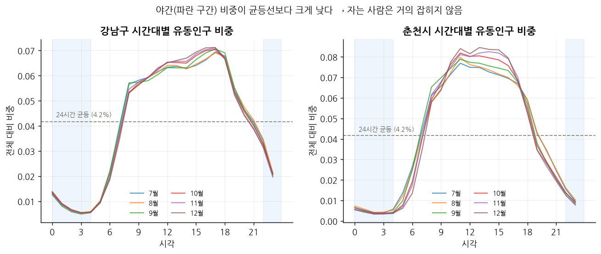

7~12월 곡선이 거의 겹칩니다. 야간 비중은 균등선(4.2%)보다 훨씬 낮은데, 활동 중인 단말만 집계되기 때문입니다.

| | 정점 | 특이점 |
| --- | --- | --- |
| 강남 | 17시 | 7~8시 출근 유입 |
| 춘천 | 11시 | 12월은 12~15시 최고 (야간 감소에 따른 상대 상승) |

## 2. 춘천 유동인구는 도로망을 따라 분포한다

> 📷 **캡쳐** · 250m 격자 공간 분포 2025년 12월 (총 유동인구 / 60대 이상 비중)

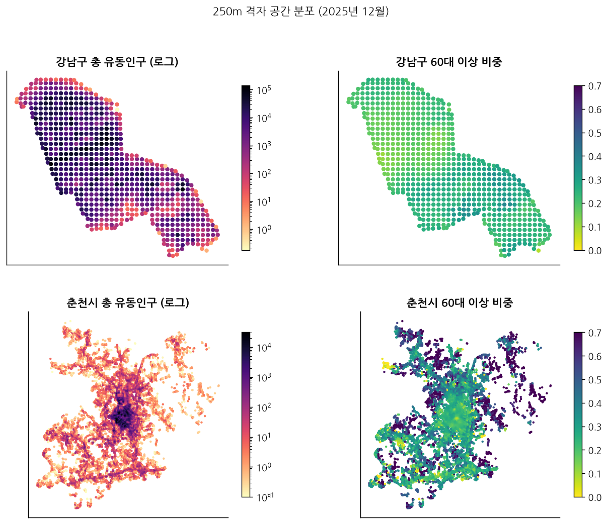

춘천 셀 상당수는 거주지가 아니라 통행로입니다. 주거 셀을 걸러내지 않으면 도로를 분석하게 됩니다.

| | 60대 이상 비중 분포 |
| --- | --- |
| 강남 | 0.2~0.3에 집중, 거의 균질 |
| 춘천 | 외곽이 0.6~0.7로 광범위하게 높음 |

강남에서는 고령 비중 축의 변별력이 없습니다.

셀별 총 유동인구 요약은 `srh_20_eda_density.csv`에 저장했다.

## 3. 유동인구 임계값은 춘천 외곽 고령 셀을 지운다

> 📷 **캡쳐** · 12월 셀당 월 총 유동인구 분포 / 기준별 잔존 셀 비율

춘천은 월 1~2명 부근, 강남은 10^4명 부근에 셀이 몰려 있습니다.

| 잔존 셀 비율 (판독) | ≥1 | ≥5 | ≥10 | ≥50 | ≥100 |
| --- | --- | --- | --- | --- | --- |
| 강남 | 0.99 | 0.98 | 0.97 | 0.91 | 0.87 |
| 춘천 | 0.78 | 0.53 | 0.43 | 0.21 | 0.14 |

단일 임계값으로 두 지역을 자를 수 없습니다. 춘천에서 임계를 올리면 외곽 고령 셀이 함께 빠지므로, 복지 맥락에서는 임계값별 결과 차이를 명시해야 합니다.

## 4. 격자군은 강남 내부를 구분하지 못한다

> 📷 **캡쳐** · 격자군별 평균 시간 프로파일 / 격자군별 셀 수

| 군집 | 셀 수 | 곡선 |
| --- | --- | --- |
| 1 | 1,754 | |
| 2 | 1,550 | |
| 6 | 1,456 | |
| 3 | 1,448 | 오후에 넓게 퍼지고 저녁까지 유지 |
| 4 | 938 | 11시 급등, 야간 0 |
| 7 | 459 | 야간 비중 최고, 평평 |

곡선 모양만으로 주거지와 비주거지가 갈립니다. 그러나 강남 셀은 사실상 군집 3에만 들어가고, 여기에 춘천 셀도 섞여 있습니다. **지역별 클러스터링이 필요합니다.**

기존 격자군별 야간비중·주간유지 요약은 `srh_22_eda_peer.csv`다.

## 5. 고령 비중 × 주간활동 이탈 후보는 고령 비중이 결정한다

> 📷 **캡쳐** · 고령비중 × 주간활동 이탈 산점도

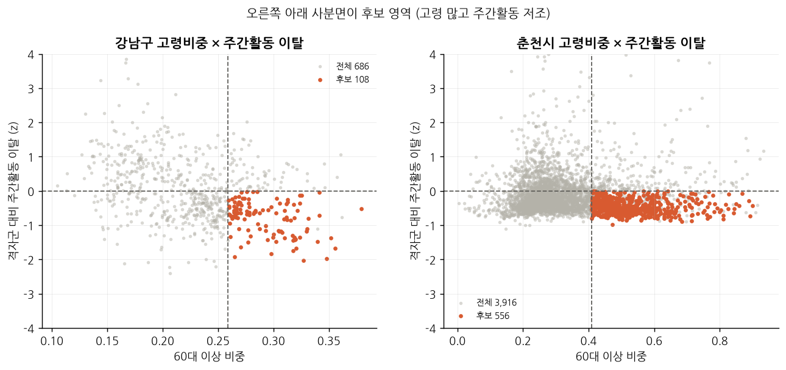

이탈은 같은 지역·군집·월 내 z-score입니다. 후보는 고령 비중 지역 상위 25%, 이탈 음수, 6개월 중 4개월 이상 음수인 셀입니다.

| | 분석 셀 | 후보 셀 |
| --- | --- | --- |
| 강남 | 686 | 108 |
| 춘천 | 3,916 | 556 |

day_hold 기준 이전 결과이며, 현재 확정 결과는 12절의 `day_share`와 새 거주 셀 정의를 따른다.

## 6. 후보 셀 지도는 고령 분포 지도에 가깝다

> 📷 **캡쳐** · 강남구/춘천시 후보 셀 위치

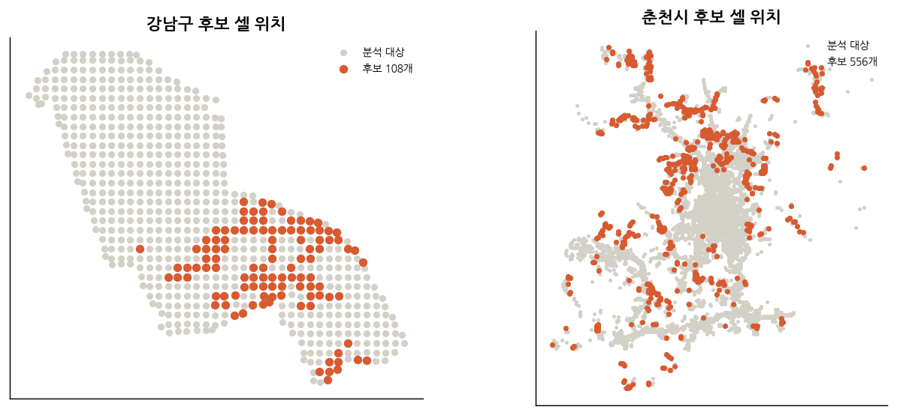

| | 후보 셀 위치 |
| --- | --- |
| 강남 | 남동쪽(일원·수서) 집중, 북서 상업지역엔 거의 없음 |
| 춘천 | 외곽도로를 따라 띠 형태 |

공간 패턴은 뚜렷하지만 고립 위험보다 고령 분포를 반영합니다.

## 7. 춘천 고령 비중은 관광 유입에 흔들린다

> 📷 **캡쳐** · 지표별 월별 추이 (총 유동인구 / 야간 비중 / 고령 비중)

| | 총 유동인구 (7월=1) | 야간 비중 중앙값 (판독) | 고령 비중 중앙값 |
| --- | --- | --- | --- |
| 강남 | 8월·10월 하락 (휴가철, 추석) | 약 0.09~0.10, 평평 | 약 0.23, 일직선 |
| 춘천 | 9월 정점 후 하락 | 약 0.035~0.05, 평평 | 8월 0.345 → 9월 0.396 → 12월 0.362 |

야간 비중은 두 지역 모두 안정적입니다. 춘천 고령 비중이 한 달에 0.05 뛰는 것은 실제 인구 변화로 볼 수 없고, 여름철 외지인 유입 영향입니다. **춘천 9~10월 변화는 고립 신호가 아닙니다.**

월별 총 유동인구 표는 `srh_21_eda_monthly.csv`다.

## 8. 고령층 카드 지표는 소표본에 부풀려진다

> 📷 **캡쳐** · 연령별 외부활동 업종 비중 / 업종 다양성 엔트로피 / 춘천 고령층 외부활동 추이

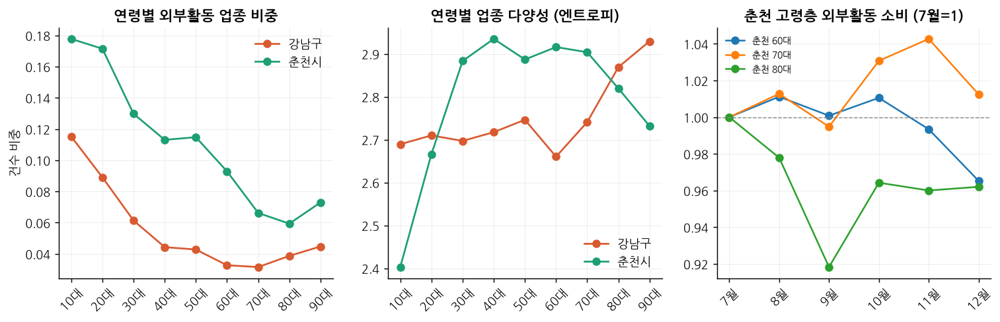

외부활동 업종 10개(기타요식, 노래방, 스포츠시설, 미용실 등, 잠정 분류)의 건수 비중은 두 지역 모두 연령이 오를수록 감소합니다.

| 지표 | 결과 | 한계 |
| --- | --- | --- |
| 업종 다양성 (91개 업종 엔트로피) | 고령층일수록 높고 강남 90대가 최고 | 90대 결제 비중 0.001, 소표본으로 엔트로피 과대 |
| 춘천 외부활동 비중 (7월=1) | 80대만 하락, 60·70대 유지 | 80대 결제 비중 0.008, 표본 변동 가능성 |

엔트로피는 지표 채택 여부를 재검토해야 합니다. 춘천 80대 하락은 고령 자체보다 외출형 소비 감소가 고립 신호라는 해석과 맞지만 근거가 약합니다.

세부 표는 `srh_17_card_age_share.csv`, `srh_18_card_entropy.csv`, `srh_19_card_social_share.csv`다.

## 9. 데이터 품질 이슈

> 📷 **캡쳐** · 12월 time 파일 중복 적재 / 주요 지표 결측률 / 결측성 신호 비율

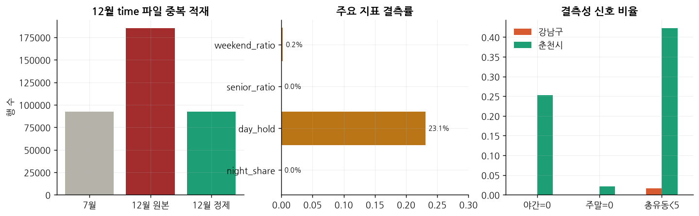

| 이슈 | 내용 |
| --- | --- |
| 12월 time 파일 중복 | 원본 행 수가 7월의 약 2배, 정제 후 7월 수준 |
| day_hold 결측 | 23.1% (weekend_ratio 0.2%, senior_ratio·night_share 0.0%) |
| 춘천 결측성 신호 (판독) | 야간=0 셀 약 25%, 총 유동인구 5 미만 약 42% (강남 약 2%) |

---

## 문제 정의 재검토

### 인구집단 축이 고령 하나로 좁혀져 있다

주제 배경 키워드는 1인 가구 급증, 사회적 관계망 약화, 고독사, **은둔형 외톨이**입니다. 은둔형 외톨이와 1인 가구 증가는 청년층 중심인데, 기존 안은 모두 60대 이상만 봅니다.

| | 지역 특성 | 예상 고립 형태 |
| --- | --- | --- |
| 강남 | 청년 1인 가구 밀집 | 관계 단절 |
| 춘천 | 고령화된 중소도시 | 활동 위축 |

### 고립 유형은 두 가지로 나뉜다

| | 유형 1 · 활동 위축 | 유형 2 · 관계 부재 |
| --- | --- | --- |
| 양상 | 활동이 좁은 시간대에 몰리고 주말·평일 구분 없음 | 활동량은 정상, 편의점·배달·무인점포 위주 소비 |
| 대상 | 고령층, 중소도시 | 청년 1인 가구, 대도시 |
| 데이터 | 통신 시간대별 인구비율 | 카드 업종 구성 |
| 개입 | 이동 수단, 가까운 거점 | 관계 형성 프로그램 |

개입 방식이 달라서 유형 구분 없이는 자원 추천이 성립하지 않습니다.

### 후보안 비교

| | 정의 | 즉시 분석 | 외부데이터 의존 | 주제 부합 | 핵심 한계 |
| --- | --- | --- | --- | --- | --- |
| A안 | 활동 단조로운 주거지역 | 가능 | 낮음 | 부분 | 단조로움과 고립의 연결이 간접적 |
| B안 | 고령 많고 활동 적은 지역 | 불가 | 높음 | 부분 | 거주인구 정규화 필요, 결과가 고령 분포 지도에 수렴 |
| C안 | 고령 비중 × 활동 단조로움 교차 | 부분 | 중간 | 부분 | 5번처럼 고령 비중이 지배, 축 독립화 필요 |
| **D안** | **셀별 고립 유형 분류** | **가능** | **중간** | **전체** | **카드 데이터 복구 필요, 비지도 분류 검증 어려움** |

A안은 현재 데이터만으로 계산되고 2번·7번 문제를 피합니다. B안은 고독사 담론과 고령 1인가구 비율 검증에 유리하지만, 강남 고령 비중 범위가 0.10~0.38로 좁고 75세 이상 구분이 불가능합니다.

D안은 지역(통신 격자)과 인구집단(카드 연령) 축을 모두 쓰고, 두 지역에서 우세 유형이 다르게 나오면 그 자체가 결과가 됩니다. 단조로움을 고립 자체가 아닌 한 유형의 흔적으로 해석해 A안의 논리 비약도 줄입니다. 다만 주제2용 카드 파일이 복구되지 않으면 업종 구성을 지역별로 볼 수 없고, 데이터1로 대체하면 거주지 필터가 빠집니다.

### 미결 쟁점

| 쟁점 | 판단 재료 |
| --- | --- |
| 단일 점수(A·B·C) vs 유형 분류(D) | 유형별 개입 차이, 두 지역 대조 |
| 고령 주축 vs 여러 연령대 중 하나 | 주제 배경의 은둔형 외톨이, 강남 청년 1인 가구 밀집 |
| 카드 데이터 미복구 시 유형 2 산출 방법 | 데이터1 대체 시 거주지 필터 손실 |

---

## 외부데이터 후보

| 데이터 | 용도 | 우선순위 |
| --- | --- | --- |
| 격자 단위 인구·가구 (SGIS) | 거주인구 정규화, 고령 비중 해석 | 1 |
| 건축물대장 표제부 | 주거 셀 식별, 격자군 재분류, 개발 사건 반증 | 1 |
| 도로망 (국가교통DB / OSM) | 통행로 셀 제외 | 1 |
| 집계구 단위 인구주택총조사 | 1인가구·고령 1인가구 비율로 사후 타당도 검증 | 2 |
| 주민등록 연령별·1인가구 (행안부) | 거주 고령 비중과 유동 고령 비중 괴리 확인 | 2 |
| 복지시설 표준데이터 (경로당·노인복지시설·복지관·주민센터) | 셀별 자원 공백 산출 | 2 |
| 사회적 기회 자원 (도서관·공원·체육시설·문화시설) | 유형별 자원 추천 | 3 |
| 대중교통 정류장 (TAGO) | 접근성 보정, 춘천 외곽 공백 과대 방지 | 3 |
| 춘천 관광지 정보 | 관광 유입 셀 특정 | 3 |
| 기상 관측 일자료 (ASOS 108·101) | 카드 소비 기상 민감도 | 4 |

## 에이전트 구조 (초안)

> 📷 **캡쳐** · 에이전트 모듈 구조도

| 모듈 | 작업 | 구현 |
| --- | --- | --- |
| 1. 신호 산출 | 주거 셀 식별, 격자군 재구성, 순위 표준화 | 코드 고정 |
| 2. 반증 검증 | 개발 사건, 표본 불안정 | LLM 개입 |
| 3. 자원 공백 | 시설 거리, 교통 보정 | 코드 고정 |
| 4. 우선순위 판단 | 위험 신뢰도 × 자원공백 매트릭스, 자원 추천 | LLM 개입 |

통신·카드·외부데이터가 모듈 1로 들어가고, 모듈 2·3을 거쳐 모듈 4에서 합쳐집니다. 다음 달 데이터로 모듈 1부터 재평가합니다.

---

## 이번 실행 결과

실행 명령은 `python notebooks/run_eda_srh.py`이며, SGIS 단독 EDA → 통신·SGIS 결합 → 카드 데이터2 순서로 수행한다. 표는 `outputs/tables/srh_*.csv`, 그림은 `outputs/fig_srh/`에 저장된다.

> 이전 실행에서는 100km 타일 전체를 SGIS 격자로 포함해 수치가 과대 집계됐다. 이번 실행부터 flow 셀이 실제로 포함된 1km 격자만 남겼다.

### 10. flow가 실제로 지나가는 1km 격자만 SGIS에 남겼다

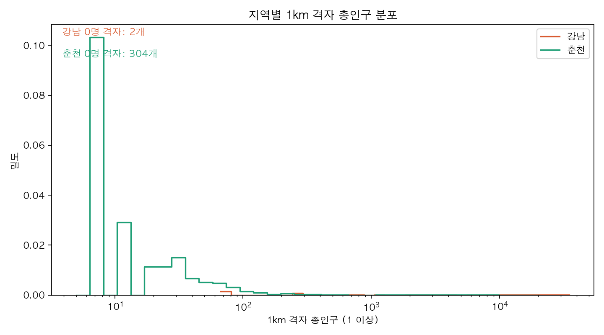

flow 셀 기준으로 남은 1km 격자는 강남 57개, 춘천 931개다. 총인구 0 격자는 강남 2개(3.5%), 춘천 304개(32.7%)이며, 총인구 50명 이상 기준 신뢰 격자 비율은 각각 84.2%, 30.2%다. 춘천 총인구 5~10명 구간 스파이크는 5 미만 값을 0 또는 5로 확률 대체하는 비밀보호 처리의 결과이며 실제 분포가 아니다. 표본 분포는 `srh_01_sgis_population_distribution.csv`, 0명 비율은 `srh_03_sgis_zero_population.csv`, 지표별 신뢰 플래그는 `srh_04_sgis_reliable_share.csv`에 저장했다.

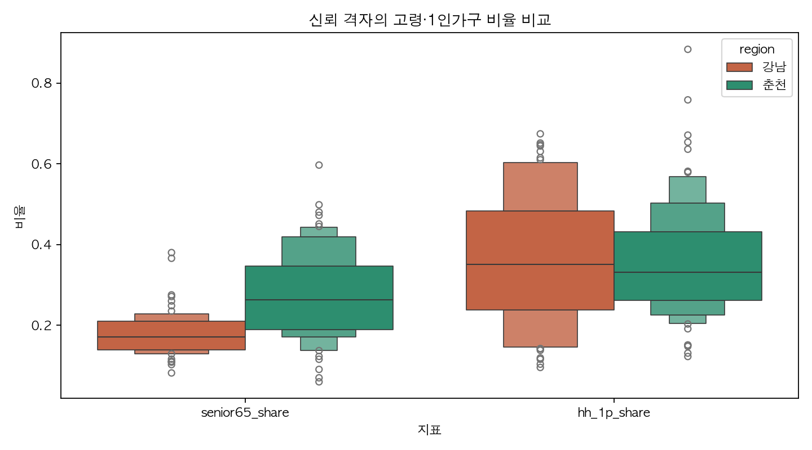

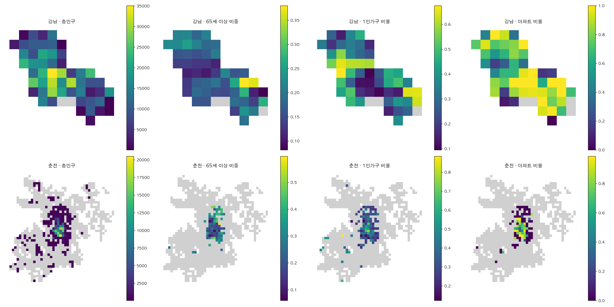

65세 이상 비율은 연령 21구간 합계를 분모로 사용하고 0~1로 클립했다. 이번 실행의 최대값은 1.000000이다. `senior65_share`는 연령합계 200 이상, 1인가구 비율은 총가구 50 이상 격자만 신뢰 지표로 사용한다. 다음 회의에서는 춘천의 0명 격자 304개를 비주거·통행 후보로 별도 처리할지 결정한다.

### 11. 250m 셀과 거주 셀의 1km 매칭

통신 셀 48,546행의 1km 매칭률은 100.0%였다. 비교는 1km 격자에서만 수행하며 250m 값을 1km 해상도로 다시 내리지 않았다. `srh_12_flow_sgis_comparison.csv`에는 1km 평균 유동, 거주인구당 유동, 유동 60+와 거주 65+의 괴리가 저장된다.

거주 셀은 (a) 지역별 야간비중 기준(강남 0.07, 춘천 0.03)과 (b) 지역별 주택 기준(강남 200호, 춘천 30호)을 각각 확인하고, 최종적으로 두 조건의 AND를 사용했다. 결과는 다음과 같다.

| 지역 | 야간 기준 단독 | 주택 기준 단독(강남 200호·춘천 30호) | AND 최종 |
| --- | ---: | ---: | ---: |
| 강남 | 669/698 | 651/698 | 625/698 |
| 춘천 | 5,688/7,393 | 2,158/7,393 | 1,952/7,393 |

강남에서 빠진 비거주 셀은 중앙·북서 업무·상업축에 주로 분포하고, 후보는 남동 주거축에 집중된다. 소속 격자의 `housing_density`도 함께 저장해 보조 조건으로 사용할 수 있다. 거주 위치와 후보 분포는 아래 그림과 `srh_05_resident_cell_summary.csv`에 있다.

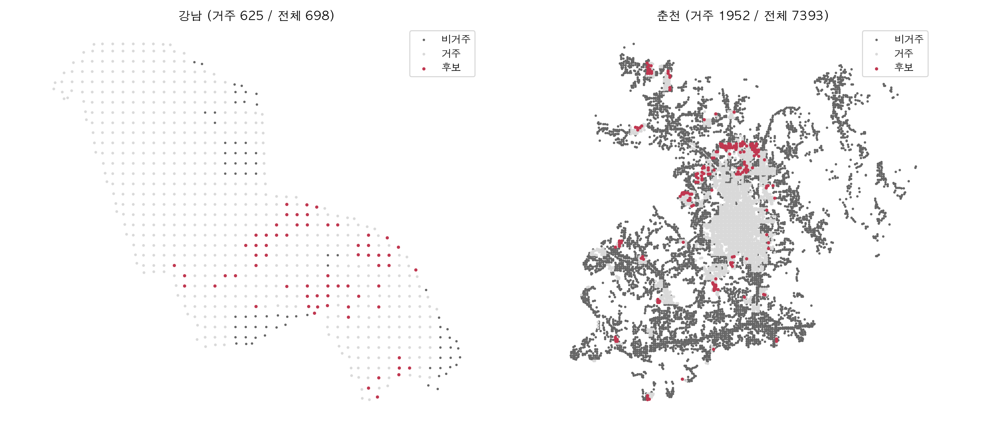

춘천 주택 기준을 0/30/100/200으로 바꾼 민감도는 각각 거주 셀 5,688/1,952/846/548개, 후보 466/192/92/63개다. 상세 조건 표는 `srh_06_resident_definition_sensitivity.csv`, 춘천 주택 민감도 표는 `srh_08_chuncheon_housing_sensitivity.csv`다.

### 12. 지역별 군집과 robust z 기반 후보

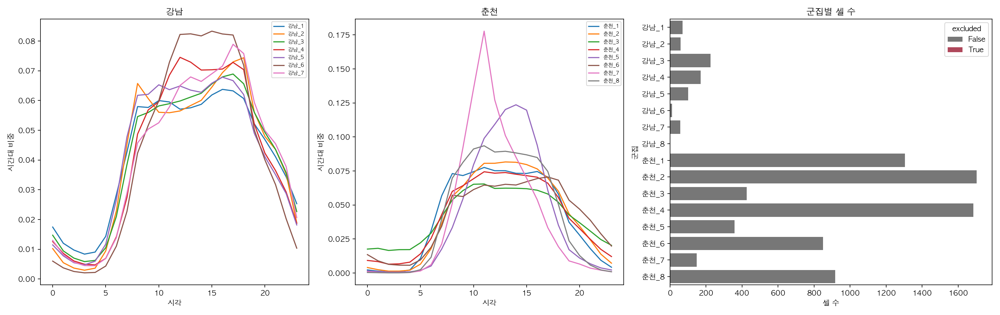

시간 프로파일 KMeans는 강남·춘천을 따로 수행했고 라벨에 지역 접두어를 붙였다. 군집별 셀 수는 그림 오른쪽 패널과 `srh_11_cluster_profiles.csv`에 있다. 강남_8처럼 셀 수가 10 미만인 군집은 1개 군집, 1셀을 이탈 지표 계산에서 제외했으며 로그에 남겼다.

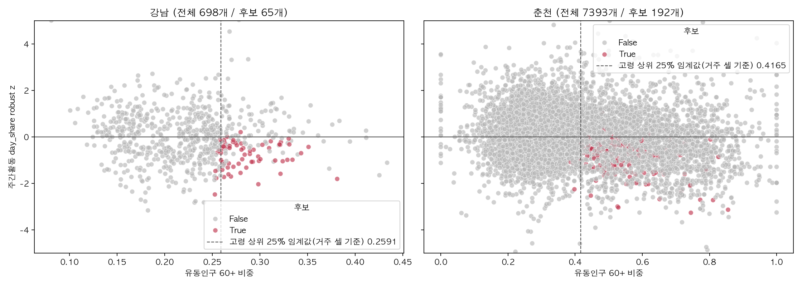

기존 `day_hold`는 야간 합계가 0이거나 작을 때 NaN/inf가 생기고 MAD 기준 이탈을 안정적으로 해석하기 어려워, 10~16시 합계/24시간 합계인 유계 `day_share`로 전환했다. 진단상 90개 지역·군집·월 그룹에서 MAD=0 그룹은 수정 전·후 모두 0개였고, z=0 셀 비율은 0.09%에서 0.13%로 바뀌었으며, 기존 `day_hold` NaN/inf와 야간합계 0 비율은 모두 23.10%였다. 새 day_share에서 MAD=0 또는 유효하지 않은 셀 6개는 후보에서 제외했다.

고령비중 상위 25% 임계값은 전체 셀 기준 강남 0.2587·춘천 0.5362에서 최종 거주 셀 기준 강남 0.2591·춘천 0.4165로 바뀌었다. 따라서 후보는 최종 거주 셀 안에서 다시 계산한 고령 상위 25%를 사용한다. 그림은 지역별 전체 셀과 후보 셀을 나누고, 고령비중 상위 25% 선과 z=0을 표시한다. 최종 후보는 강남 65개, 춘천 192개다. 12월 단면에서 z>0인 셀이 보일 수 있으나, 후보 판정은 6개월 중 4개월 이상 지속 조건으로 계산한다.

후보와 비후보 거주 셀의 소속 1km 격자 SGIS 분포도 비교했다. 강남 후보의 `senior65_share` 중앙값은 0.198, 비후보 거주 셀은 0.167이며, 춘천은 각각 0.390과 0.318이다. 후보가 고령 분포의 영향을 함께 받으므로 활동 이탈 축이 고령 축과 완전히 독립적이라고 해석할 수 없다. 상세 표는 `srh_09_candidate_validity.csv`다.

위 비교는 고령 조건이 선정에 들어가 있어 차이가 나는 것이 당연하므로, 고령 상위 25%(거주 셀 기준)를 4개월 이상 통과한 거주 셀만 모집단으로 다시 잡고 그 안에서 후보와 비후보를 비교했다(`population = senior_top25`). 강남은 후보 65개·비후보 89개의 `senior65_share` 중앙값이 0.198로 같고(사분위 0.174~0.235 vs 0.167~0.260), 춘천은 후보 192개 0.390(0.353~0.472), 비후보 218개 0.375(0.319~0.434)로 0.015 차이다. `hh_1p_share` 중앙값도 강남 0.254 vs 0.237, 춘천 0.302 vs 0.325로 사분위가 크게 겹친다. 고령 상위 모집단 안에서는 차이가 작으므로 이탈 축이 고령 축과 독립적이다. 다만 1km 격자값이라 같은 격자에 속한 250m 셀이 같은 값을 공유하므로 셀 단위 변별력은 제한적이다.

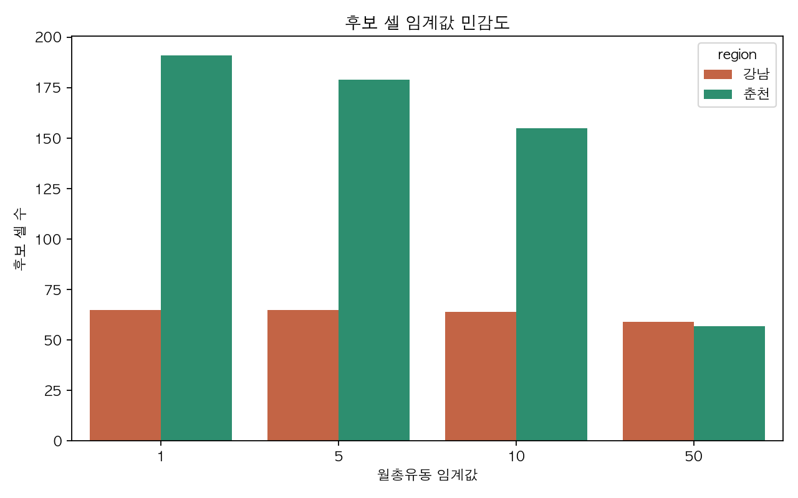

월총유동 임계값 1/5/10/50에서 후보 수는 별도 `srh_10_threshold_sensitivity.csv`에 기록했다. 강남은 65/65/64/59개, 춘천은 191/179/155/57개다. 후보는 고립 확정이 아니라 고령·활동위축 신호 후보다. 다음 회의에서는 야간 기준과 월 유동 임계값을 어떤 조합으로 고정할지 결정한다.

### 13. 카드 데이터2는 월별 그림 대신 연령대별 지역 차이를 본다

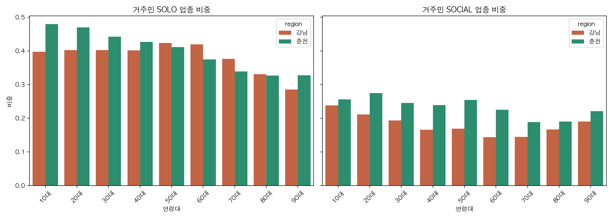

월별 SOLO 비중은 두 지역이 함께 움직여 공통 계절 요인을 분리하기 어렵고 그림에서는 제외했다. 월별 원자료는 `srh_15_card2_solo_month.csv`로만 남겼다. 대신 거주민 연령대별 SOLO/SOCIAL 비중을 지역별로 비교한다. 거주 판정은 강남 가맹점의 서울 거주, 춘천 가맹점의 강원 거주다.

춘천 외지인 소비 비중은 2025년 7월 16.4%, 8월 18.1%, 9월 17.5%, 10월 20.5%, 11월 18.3%, 12월 15.9%로 월별 변동이 있다. 월별 거주·외지 비중은 `srh_13_card2_home_share.csv`다. 연령·업종 비중, 표본 크기, 엔트로피, 주말·평일 비율은 각각 `srh_14_card2_age_industry_share.csv`, `srh_16_card2_age_sample.csv`, `srh_17_card2_entropy.csv`, `srh_18_card2_weekend_weekday.csv`에 저장했다.