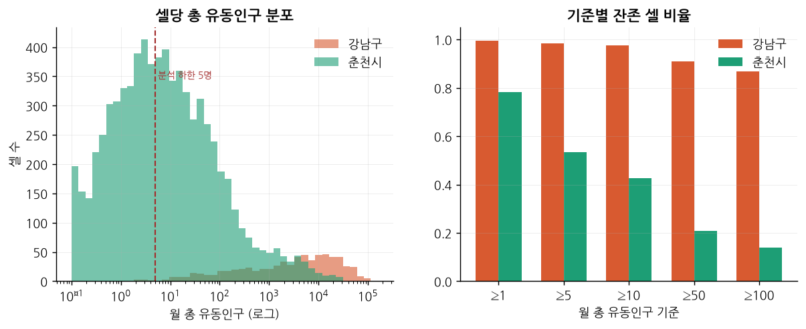
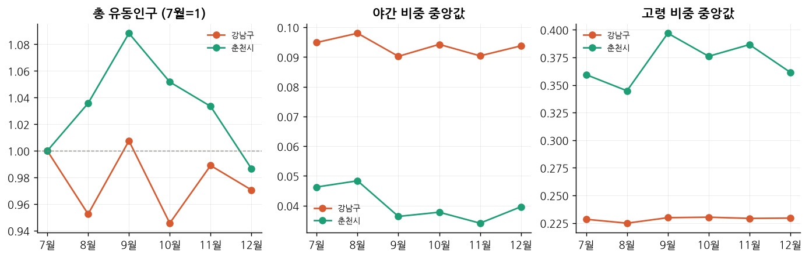
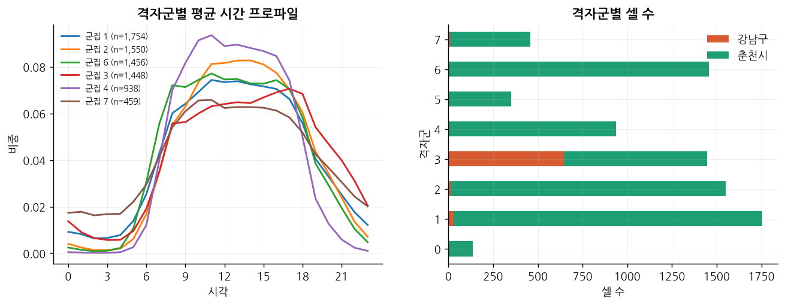
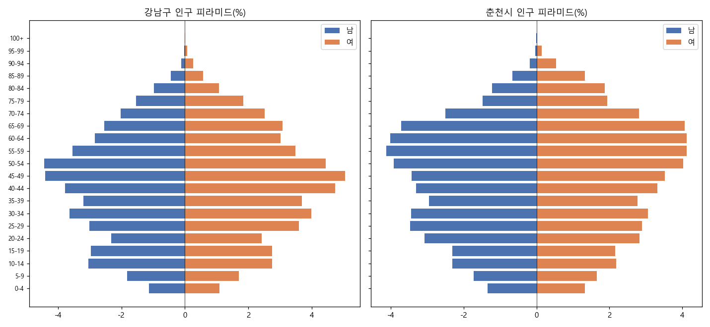
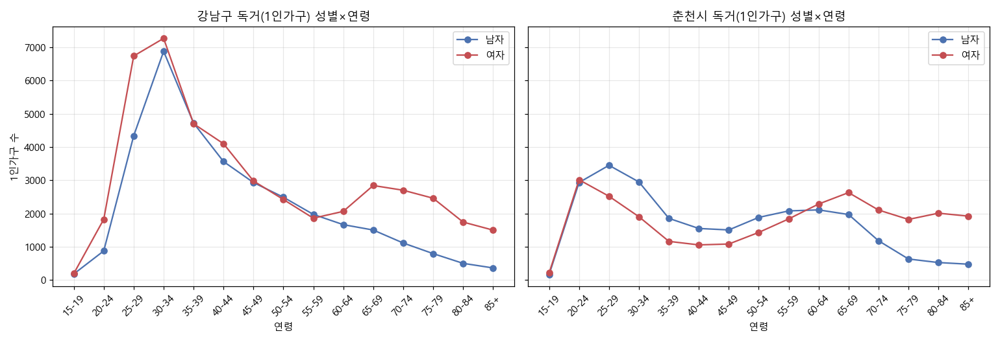
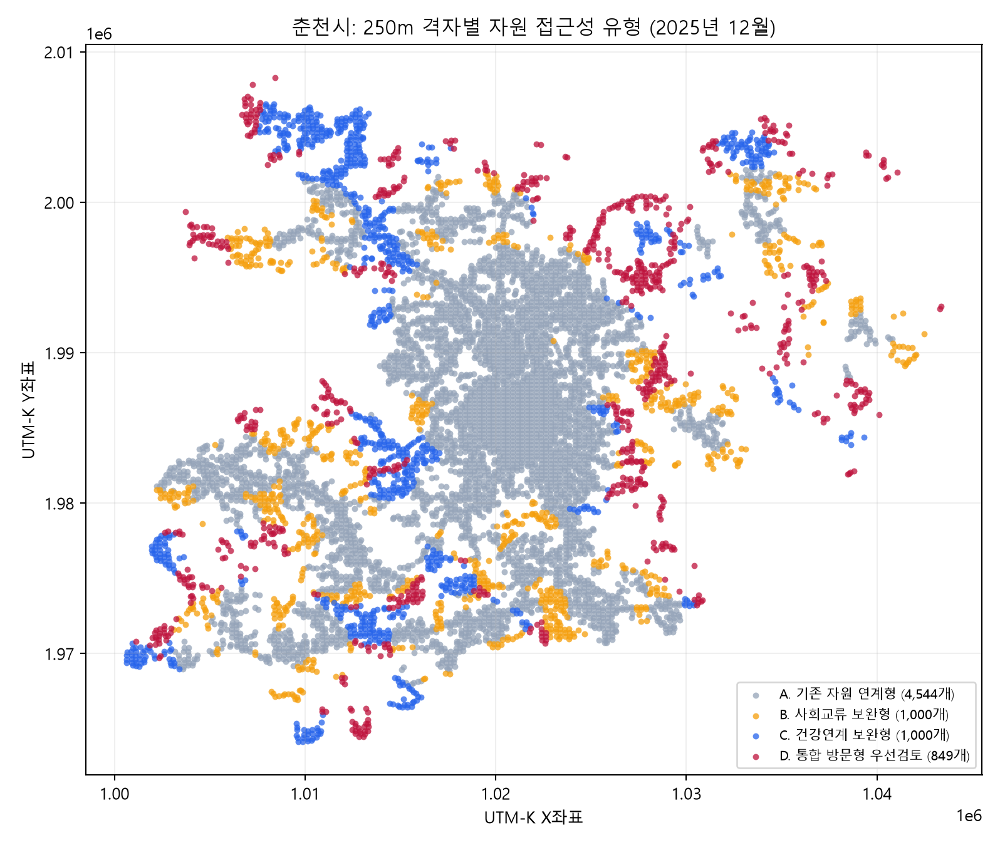
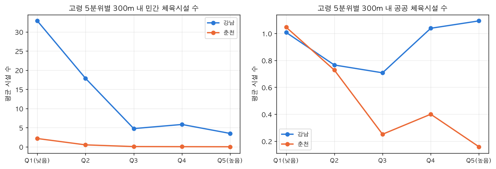
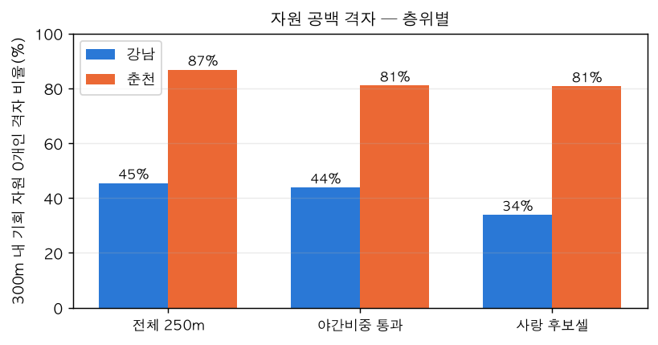
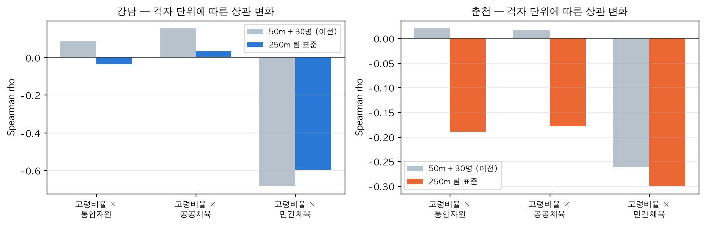

# 팀 EDA 통합 정리

2026-09-30 기준 · 팀 EDA를 제공 데이터 / 외부 데이터로 나눠 합침

## 분석 단위

격자 분석의 팀 표준은 **250m**다 (`preprocessed/flow_cell.parquet`,
`cell_id = floor(X/250)_floor(Y/250)`, 거리 기준점은 격자 중심).

| 층위 | 강남 | 춘천 | 정의 |
| --- | --- | --- | --- |
| 전체 250m 격자 | 698 | 7,393 | 기본 모집단 |
| 거주셀 | 625 | 1,952 | 야간 비중 + 주택 수 조건 (3절) |
| 활동위축 후보셀 | 65 | 192 | 고령 상위 25% + 이탈 지속 (7절) |

거주셀 조건은 SGIS 주택 수가 필요해 자원 접근성 분석에는 아직 미적용이다.

---
---

# Part 1. 제공 데이터 (SK 유동인구 + 신한카드)

## 1. 데이터 구조와 해석 전제

분석 전에 공유해야 하는 제약이다.

### 통신 3개 테이블은 합칠 수 없다

`flow_age_pop` / `flow_time_pop` / `flow_wkdy_pop` 는 같은 모집단을 **다른 축으로 자른 주변분포**다
(격자별 합계 상관 1.0000).

```
같은 격자, 같은 달의 유동인구 100명을
age  → 남20대 30 / 여30대 25 / 남60대 20 ...   ← 누구인가
time → 08시 10 / 12시 25 / 18시 30 ...          ← 언제인가
wkdy → 월 15 / 화 14 / ... / 일 9               ← 무슨 요일인가
```

**"60대가 밤 10시에 어디 있었나"는 알 수 없다.** 야간·요일 지표는 전 연령 합산으로만 쓸 수 있다.

### 값은 사람 수가 아니라 추정치다

0보다 큰 값 93만 개 중 정수는 0.3%, 최솟값은 0.03명이다. 표본에 가중치를 곱해 확장 추정한 값이다.
**소규모 격자의 값은 실체가 없다.**

### 월별 "일평균"이다

공지에는 "일별/시간대별"로 적혀 있으나 실제 테이블은 월별 일평균이다.
**격자당 관측 시점이 6개뿐**이라 전년 동월 비교도, 계절 분리도 불가능하다.

### 야간 유동인구는 거주자가 아니다

통신 데이터는 **활동 중인 단말만** 집계한다. 야간 비중이 균등선(4.2%)보다 훨씬 낮은 이유다.
"야간 체류가 많다 = 거기 산다"가 아니라 **주거 가능성 지표**로만 쓴다.

---

## 2. 공간 단위 — 50m는 너무 작다

50m 격자에서 춘천은 칸당 유동인구가 1명 미만이다.

| | 격자당 일평균 유동인구 |
| --- | --- |
| 강남 | 480명 (지니계수 0.73) |
| 춘천 | 22명 (지니계수 0.90) |

춘천 셀 상당수는 거주지가 아니라 **도로망을 따라 뻗은 통행로**다.
주거셀을 골라내지 않으면 **사람이 아니라 도로를 분석하게 된다.**

### 유동인구 임계값은 두 지역을 동시에 자르지 못한다

임계값별 잔존 셀 비율(250m 기준):

| 임계값 | ≥1 | ≥5 | ≥10 | ≥50 | ≥100 |
| --- | --- | --- | --- | --- | --- |
| 강남 | 0.99 | 0.98 | 0.97 | 0.91 | 0.87 |
| 춘천 | 0.78 | 0.53 | 0.43 | 0.21 | 0.14 |

**강남은 무엇으로 잘라도 영향이 없고, 춘천만 급감한다.**

임계값을 올리면 춘천 **외곽 고령 셀이 함께 제거된다.** 통계적으로는 옳지만
복지 정책 맥락에서는 "사람이 적게 사는 곳은 보지 않았다"가 된다.
→ 여러 기준에서 결과가 어떻게 달라지는지 명시해야 한다.



*왼쪽: 춘천 셀은 월 1~2명 부근에 몰려 있고 강남은 10⁴명 부근에 퍼져 있다.
오른쪽: 임계값을 올려도 강남은 90% 가까이 남지만 춘천은 급감한다.*

---

## 3. 거주셀 정의 — 통행로 걸러내기

두 조건을 모두 만족하는 셀만 거주셀로 본다.

| 조건 | 강남 | 춘천 |
| --- | --- | --- |
| (a) 야간 비중 | ≥ 0.07 | ≥ 0.03 |
| (b) 소속 1km 격자 주택 수 | ≥ 200호 | ≥ 30호 |

| 정의 | 강남 거주셀 | 춘천 거주셀 |
| --- | --- | --- |
| 야간 단독 | 669 / 698 (95.8%) | 5,688 / 7,393 (76.9%) |
| 주택 단독 | 651 (93.3%) | 2,158 (29.2%) |
| **야간 AND 주택 (최종)** | **625 (89.5%)** | **1,952 (26.4%)** |

춘천은 주택 기준값에 매우 민감하다 — 0호면 후보 466개, 30호면 192개, 200호면 63개.
**기준 고정 근거가 필요하다.** (미결 쟁점)

강남 비거주셀은 중앙·북서 업무·상업축에 분포한다.

---

## 4. 유동인구 패턴

### 시간대 — 계절과 무관하다

7~12월 곡선이 거의 일치한다. **시간대 패턴에 계절 영향이 없어** 6개월 평균 벡터를
군집화에 그대로 쓸 수 있다.

| | 정점 | 특이점 |
| --- | --- | --- |
| 강남 | **17시** | 7~8시 출근 유입 |
| 춘천 | **11시** | 12월은 12~15시 최고 — 야간 감소에 따른 상대 상승 |

50m 집계에서는 두 지역 24시간 프로파일이 **거의 겹쳤다**(차이는 야간 비중뿐: 강남 5.0% / 춘천 2.8%).
250m·군집 단위로 내려가야 차이가 드러난다.

### 요일 — 뚜렷하게 갈린다

| | 일요일 유동인구 비중 | 카드 결제 요일 지수(평일=100) |
| --- | --- | --- |
| 강남 | 10.2% | 일요일 79.7 |
| 춘천 | 13.1% | 토요일 113.2 |

카드 집계도 같다 — 주말/평일 결제 비율이 **강남 0.83, 춘천 0.98**이다.
강남은 업무 유입형, 춘천은 주말·평일 구분이 거의 없다.

> 활동위축 유형의 "주말·평일 구분 없음" 신호는 **지역 전체 수준에서 춘천에 더 부합**한다.

### 월별 — 이벤트가 섞여 있다

- 강남: 8월 하락(휴가철), 10월 하락(추석). 지그재그
- 춘천: 9월 정점 후 하락 (원인은 5절)
- 야간 비중: **두 지역 모두 평평**(강남 0.09~0.10, 춘천 0.035~0.05). 주거 구조가 몇 달 사이
  바뀌지 않으므로 당연하고, **지표로서 안정적**이라는 뜻이기도 하다

---

## 5. ⚠ 고령 비중의 함정 — 춘천은 관광에 흔들린다

춘천 고령 비중 중앙값이 **8월 0.345 → 9월 0.396 → 12월 0.362** 로 움직인다.
실제 고령 인구가 한 달 만에 5%p 변할 수는 없다. **여름철 외지인 유입이 빠지면서 생긴 착시**다.

카드 데이터가 이를 뒷받침한다 — 춘천 외지 소비 비중이 10월에 20.5%로 정점이다.



*가운데: 야간 비중은 두 지역 모두 평평해 안정적이다.
오른쪽: 춘천 고령 비중만 9월에 솟았다 내려온다 — 관광 유입 착시.*

> **춘천의 9~10월 고령 비중 변화를 고립 신호로 해석하면 안 된다.**

강남은 유입 규모가 커서 계절 변동이 묻힌다(약 0.23, 거의 일직선).

### 고령 비중은 강남에서 변별력이 없다

| | 격자별 고령 비중 |
| --- | --- |
| 강남 | **0.2~0.3에 몰려 거의 균질** |
| 춘천 | 외곽이 0.6~0.7로 광범위하게 높음 |

**강남에서는 고령 비중 축 단독으로 셀을 구분할 수 없다.**
50m 집계도 같다 — 표준편차 강남 6.4 vs 춘천 22.4.

### 유동 고령 ≠ 거주 고령

SGIS 1km 격자와 비교한 결과다.

| | 유동 60+ 비중 | 거주 65+ 비율 | 괴리 |
| --- | --- | --- | --- |
| 강남 | 0.231 | 0.172 | **+0.036** |
| 춘천(신뢰격자) | 0.333 | 0.347 | −0.007 |

**강남은 유동 고령 비중이 거주보다 높다**(외부 유입 고령층). 춘천 신뢰격자는 거의 일치한다.
→ 강남에서 유동인구 고령 비중을 그대로 쓰면 과대 추정된다.

---

## 6. 격자군(클러스터링) — 지역별로 따로 해야 한다

셀별 24시간 비중 벡터(6개월 평균) → 표준화 → KMeans(k=8).
6개월치뿐이라 과거와 비교할 수 없으니, **하루를 비슷하게 쓰는 셀끼리 묶어 그 안에서 비교**한다.

### 1차 시도는 실패했다

두 지역을 합쳐 군집화하니 **강남 셀이 사실상 군집 3 하나에만 편입**되고 춘천 셀과 섞였다.
강남 내부를 전혀 구분하지 못했다. → **지역별 분리 수행**으로 전환.

### 지역별 군집 프로파일

| 군집 | 셀 수 | 야간비중 | 주간비중 | 고령비중 | 해석 |
| --- | --- | --- | --- | --- | --- |
| 강남_1 | 70 | 0.116 | 0.419 | 0.277 | 야간 최고, 고령 높은 주거형 |
| 강남_3 | 226 | 0.102 | 0.434 | 0.246 | 최다 군집, 표준 주거형 |
| 강남_4 | 171 | 0.085 | 0.487 | 0.179 | 주간활동 높음, 고령 낮음 |
| 강남_6 | 11 | 0.047 | 0.545 | 0.137 | 업무지구형, 야간 최저 |
| 춘천_2 | 1,703 | 0.033 | 0.554 | 0.360 | 최다 군집 |
| 춘천_3 | 426 | 0.132 | 0.440 | **0.560** | 야간 최고, 고령 높음, 평평 |
| 춘천_4 | 1,684 | 0.068 | 0.506 | 0.420 | 주거형, **후보 대부분 소속** |
| 춘천_7 | 148 | 0.005 | 0.750 | 0.563 | 정오 집중, 야간 0 |

곡선 모양만으로 **주거형/비주거형을 가를 수 있다.**



*군집마다 곡선이 확실히 다르다. 11시에 뾰족하고 야간이 0인 군집은 비주거형,
야간 비중이 높고 평평한 군집은 주거형이다.*

---

## 7. 이탈 지표와 후보셀

### 지표를 바꿨다

1차 지표 `day_hold`(낮/야간)는 야간 합계가 0이면 NaN/inf가 발생해 **결측률이 23.1%**였다.
→ `day_share`(10~16시 ÷ 24시간, 0~1 유계)로 전환. 결측 없음.

이탈 지표는 **같은 지역 · 같은 군집 · 같은 달** 안에서 중앙값·MAD 기준 robust z로 계산한다.
(평균·표준편차 z는 춘천 셀 대부분이 −1~0에 몰려 변별이 안 됐다.)

### 후보 조건

1. 거주셀
2. 그 지역 고령 비중 **상위 25%**
3. `day_share` robust z가 음수인 달이 **6개월 중 4개월 이상**

| | 후보 셀 | 지속 4개월 | 5개월 | 6개월 |
| --- | --- | --- | --- | --- |
| 강남 | **65** | 13 | 13 | **39 (60%)** |
| 춘천 | **192** | **84 (44%)** | 56 | 52 |

강남 후보는 6개월 전부 음수인 셀이 60%로 지속성이 높다. 춘천은 4개월 셀이 44%다.
**춘천 후보의 73%가 춘천_4 한 군집에 집중**돼 있다.

공간 분포는 **강남 남동 주거축(일원·수서) 집중, 북서 상업축 거의 없음 / 춘천 외곽 도로를 따라 띠 형태**다.

### 고령 축과의 독립성 검증 — 통과

1차 결과의 문제는 **후보 지도가 고령 분포 지도와 사실상 같다**는 것이었다.
고령 상위 25%를 통과한 셀만 모집단으로 재비교했다.

| 모집단 | 그룹 | senior65_share 중앙값 |
| --- | --- | --- |
| 고령 상위 25% · 강남 | 비후보 (89) | 0.198 |
| 고령 상위 25% · 강남 | 후보 (65) | **0.198 (동일)** |
| 고령 상위 25% · 춘천 | 비후보 (218) | 0.375 |
| 고령 상위 25% · 춘천 | 후보 (192) | 0.390 (0.015 차이) |

`hh_1p_share`도 사분위가 대부분 중첩된다.
→ **고령 상위 모집단 안에서 이탈 축과 고령 축은 독립**이다. 1차의 "고령 분포 지도" 문제는 해소됐다.

한계: 1km 격자 값이라 같은 격자의 250m 셀이 동일 값을 공유한다. 셀 단위 변별력은 제한적이다.

---

## 8. 카드 데이터

### 기본 구조

184일 전수 존재, 결측 0. 강남 결제 건수 비중 91.3% / 춘천 8.7%. 12~17시에 45.1% 집중.

### ⚠ 금액이 아니라 건수로 봐야 한다

**비소비성 업종이 금액의 50%를 차지한다.** 강남만 보면 세금공과금 단독으로 결제액의 30.1%다.
→ **건수 기준 + 비소비성 업종 제외**로 진행한다.

가맹점 소재지 기준이라 전국 온라인 결제가 강남으로 잡힐 수 있다.
**"강남 = 온라인 소비"로 단정하면 안 된다.**

### 캘린더 이벤트를 통제해야 한다

2025 추석(10/6 월) 당일 강남이 **평상 평일의 40% 수준**으로 급감했다. 강남은 오피스 상권이라
명절 귀성으로 공동화되고 춘천은 덜 빠진다.
→ 통제하지 않으면 "10월 강남 소비 붕괴" 같은 오독이 나온다.

### 거주지 — 강남 외지인 60% / 춘천 지역민 82%

데이터2 기준. 두 사람이 독립적으로 계산해 **수치가 일치**한다.

| | 7월 | 10월 | 12월 |
| --- | --- | --- | --- |
| 강남 거주(서울) | 40.5% | 39.5% | 39.1% |
| 춘천 거주(강원) | 83.6% | 79.5% | 84.0% |

춘천 외지 비중의 10월 정점은 **통신 고령 비중 변동과 같은 관광 유입 해석을 뒷받침**한다.
강남은 경기 유입이 약 37배로 절대 규모가 압도적이다.

### 연령별 로컬 결제 비율 — U자 곡선

| | 20대 | 40대 | 60대 | 80대 | 90대 |
| --- | --- | --- | --- | --- | --- |
| 강남 | 43.1% | **37.0%** | 39.6% | 62.5% | **75.0%** |
| 춘천 | **74.1%** | 83.9% | 86.0% | 92.2% | **92.6%** |

40대 전후에서 가장 멀리 움직이고 고령으로 갈수록 거주지 근처에서만 결제한다.

> ⚠ **이 신호는 격자로 내려오지 않는다.** 3부 참조.

### 업종 구성 — 4개 그룹 (거주민만 집계)

| | 강남 20대 | 강남 60대 | 강남 90대 | 춘천 20대 | 춘천 60대 | 춘천 90대 |
| --- | --- | --- | --- | --- | --- | --- |
| SOLO | 0.402 | 0.419 | 0.285 | 0.469 | 0.374 | 0.327 |
| SOCIAL | 0.211 | 0.144 | 0.190 | 0.274 | 0.225 | 0.221 |
| MEDICAL | 0.037 | 0.078 | **0.171** | 0.045 | 0.135 | **0.276** |

- **춘천이 전 연령에서 SOLO 비중이 높다** (특히 10~20대 0.47~0.48)
- SOCIAL은 강남에서 연령 상승에 따라 감소, 춘천은 50대까지 유지 후 감소
- MEDICAL은 두 지역 모두 급증, 춘천 80대 이상 0.26 이상

### ⚠ 엔트로피 지표는 소표본에 오염됐다

1차(카드1, 전체) 결과에서는 엔트로피가 **고령층일수록 높고 강남 90대가 최고**로 나왔다.
"다양성이 높으면 사회활동이 활발하다"로 읽으면 **90대가 가장 활발하다**는 결론이 된다.

원인은 표본이다.

| 연령대 | 강남 결제 비중 | 춘천 결제 비중 |
| --- | --- | --- |
| 80대 | 1.1% | 0.9% |
| 90대 | **0.1%** | **0.04%** |

업종당 표본이 극히 적어 엔트로피가 부풀려진다.

**거주민 필터(카드2) 후 재계산하니 40~50대 정점, 이후 완만한 감소**로 정상화됐다.
춘천 80대는 표본 부족으로 산출 불가, 90대는 두 지역 모두 미산출.

> 따라서 "춘천 90대 −0.164, 강남 90대 −0.040" 같은 수치는 **소표본 노이즈**다.
> 고령 끝단의 다양성 축소 주장은 근거가 없다.

같은 이유로 "춘천 80대만 외부활동 비중 하락"도 표본 0.008이라 흔들릴 수 있다.

### 성·연령 구성

두 도시 모두 30·40대 중심이다. 중장년 남성 총합은 **강남 29.6% vs 춘천 30.9%로 차이가 없다.**

### ⚠ 카드와 통신을 서로의 대리지표로 쓰면 안 된다

신한 소비와 SKT 유동의 성·연령 프로파일 상관은 **강남 r=0.88, 춘천 r=0.06**이다.

이는 정합성이나 신뢰도가 아니라 **프로파일 유사도일 뿐**이다.
두 데이터는 서로 다른 모집단이고(카드 소비자 vs 통신 이용자), n이 작고 비독립 관측이라 p값도 무효다.
춘천 상관이 낮은 주원인은 10대 카드 부재다.

→ **두 데이터를 결합할 때 성·연령을 서로의 대리지표로 쓰지 않는다.**

---

## 9. 제공 데이터 품질 이슈

| 이슈 | 내용 | 상태 |
| --- | --- | --- |
| 12월 중복 | `flow_time_pop_202512`(185,090→92,545), `flow_wkdy_pop_202512`(242,534→121,267) 전 행이 2번씩 | `src/loaders.py` 자동 제거 |
| 데이터2 컬럼 누락 | 최초 배포본은 5컬럼, `TA_YMD`·`MCT_SGG_CD`·`MCT_RY_CD` 없음 | **2026-09 재배포로 복구** |
| 60대 이상 통합 | 통신은 60GU 한 구간 → **75세 이상 구분 불가** | 해결 불가 |
| 좌표계 | UTM-K(EPSG:5179), 정의서 명시 | 확인 완료 |

9월 중순 시점 문서의 **"데이터2는 날짜·업종·가맹점 지역이 없어 사용 불가"는 이제 틀린 서술**이다.

---
---

# Part 2. 외부 데이터

## 1. 확보 현황

| 데이터 | 단위 | 상태 |
| --- | --- | --- |
| SGIS 격자 인구·가구 | 1km 격자 | 확보 |
| 주민등록 연령별 인구, 1인가구, 건축물대장 | 시군구 / 건물 | 확보 |
| 경로당·마을회관, 보건소·보건지소·보건진료소 | 좌표 | 확보 |
| 체육시설·도서관·문화시설·공공시설개방·도시공원·사회복지시설 | 좌표 | 확보 (6종) |

---

## 2. SGIS 격자 인구·가구

1km 격자 단위. 통신 셀 48,546행의 매칭률 **100.0%**.

| | 격자 수 | 총인구 합계 | 총인구 중앙값 |
| --- | --- | --- | --- |
| 강남 | 57 | 695,382 | 10,124 |
| 춘천 | 931 | 293,511 | **8** |

### ⚠ 춘천은 SGIS도 신뢰하기 어렵다

| | 0명 격자 | 비율 | 유동 신뢰격자 비율 | senior65 신뢰 | hh_1p 신뢰 |
| --- | --- | --- | --- | --- | --- |
| 강남 | 2 | 3.5% | 96.5% | 94.7% | 94.7% |
| 춘천 | **304** | **32.7%** | **22.9%** | **8.9%** | **12.1%** |

춘천의 5~10명 구간 스파이크는 **5 미만 값을 0 또는 5로 확률 대체하는 통계청 비밀보호 처리** 결과다.
실제 분포가 아니다.

**춘천은 senior65 지표를 8.9% 격자에서만 신뢰할 수 있다.** 이 제약이 모든 SGIS 기반 분석에 걸린다.

### 주거 구조

| 지표 | 강남 | 춘천 |
| --- | --- | --- |
| senior65_share | 0.180 | 0.275 |
| **hh_1p_share** | **0.361** | **0.353** |
| apt_share | 0.702 | 0.277 |
| detached_share | 0.066 | 0.657 |

강남은 고령 낮고 아파트 위주, 춘천은 고령 높고 단독주택 위주다.
**1인가구 비율은 두 지역이 0.35 내외로 거의 같다** — 고령과 달리 지역차가 없는 축이다.

---

## 3. 인구·건물

### 인구 구조 — 강남 중년형 / 춘천 고령형

| | 강남 | 춘천 |
| --- | --- | --- |
| 전체 인구 | 55.6만 | 28.5만 (강남의 0.51배) |
| 고령화율(65+) | 17.1% | 22.6% |
| 초고령(85+) | 1.5% | **2.9% (2배)** |
| 인구 피크 연령 | 45–49세 | 55–59세 |

무게중심이 춘천이 약 10년 더 고령이다.
강남은 20~40대에서 여초, 춘천은 20~34세에서 남초(대학·직업).



*강남은 45–49세가 가장 두꺼운 중년형, 춘천은 55–59세가 피크인 고령형이다.*

### ⚠ 독거노인 절대수는 거의 같다

**가장 반직관적인 발견이다.**

| 분모 | 강남 | 춘천 |
| --- | --- | --- |
| 전체 인구 | 55.6만 | 28.5만 |
| 고령화율 | 17.1% | 22.6% |
| **독거노인 절대수** | **15,540** | **15,291 (거의 같음)** |
| 고령 중 독거율 | 16.3% | 23.8% |
| 전체 중 독거노인 | 2.8% | **5.4% (1.9배)** |

강남은 인구가 1.95배지만 고령화율이 낮아 65+ 인구가 1.5배에 그치고, 그중 독거 성향도 낮다.
춘천은 인구가 절반인데 고령·독거 성향이 모두 높아 절대수를 따라잡는다.

> **비율 = 취약도 / 절대수 = 개입 규모**로 나눠 써야 한다.
> "고령 중 독거율"은 가구 수 ÷ 인구 수라 개인 단위 독거율이 아니다. "4명 중 1명"으로 읽으면 안 된다.

### 1인가구 — 강남 청년 단봉 / 춘천 쌍봉

| | 강남 | 춘천 |
| --- | --- | --- |
| 형태 | 청년 **단봉** (30–34 정점) | 청년 + 고령 **쌍봉** (25–29, 65–69) |
| 청년(20–39) 비중 | **47%** | 38% |
| 고령(65+) 비중 | 20% | **29%** |

**독거는 단일 집단이 아니다.**

| 유형 | 규모 | 성격 |
| --- | --- | --- |
| 청년 독거 | 강남 우세 (25–34 여성 우세 / 춘천 20–34 남성 우세) | 관계 결핍형 |
| **중장년 독거남(40–64)** | **강남 12,633 / 춘천 9,136** | **고독사 최다 위험군** |
| 초고령 독거녀 | 독거노인 중 여성 강남 72% / 춘천 69% | 돌봄 필요 |

개입 대상과 방식이 각각 다르다.



*강남은 30–34세 청년 단봉, 춘천은 25–29세와 65–69세 쌍봉이다.
춘천은 40~64세에서 남성 독거가 여성보다 많다.*

### 건물

| 지표 | 강남 | 춘천 |
| --- | --- | --- |
| 노후(30년+) 비율 | 51% | 49% |
| 1~2층 비율 | — | **77%** |
| 5층 이상 | 29% | — |
| 연면적 중앙값 | 506㎡ | **118㎡ (1/4)** |
| 위반건축물 | **6.5%** | 0.9% |
| 노후 단독주택 | 3,606 | **9,478** |

노후율은 비슷하지만 성격이 다르다 — 강남은 "오래된 도심", 춘천은 "노후와 신축이 섞인 확산형".
**저층·소형 단독 밀집은 문헌상 고립 취약 주거환경의 전형**이다.

위반건축물은 강남이 훨씬 많지만(다가구 불법 증축 추정), **"관리 사각 = 고립"으로 직결하면 안 된다.**

### 건물 × 유동 결합 — 강남만 신호가 잡힌다

250m 격자에서 노후 비율과 고령 유동의 상관이다.

| | rho |
| --- | --- |
| 강남 | **0.56** — 노후 주거와 고령 유동이 함께 몰림 |
| 춘천 | **−0.16** — 약하거나 반대 |

**강남은 특정 개입 지점을 짚을 수 있고, 춘천은 단독주거가 전역에 흩어져 위험이 지점으로 모이지 않는다.**

---

## 4. 복지시설 — 경로당·보건기관

### 경로당·마을회관

| | 원자료 | 운영 | 공간분석 사용 | 기준일 |
| --- | --- | --- | --- | --- |
| 춘천 | 391 | 387 (경로당 365 + 마을회관 22) | 387 | 2025-07-09 |
| 강남 | 178 | 166 | **163** | **2024-07-09** |

강남 경로당 3곳의 **경도 값이 위도와 동일한 오류**(은곡·방죽1·자곡)가 있어 제외했다. 주소 기반 보정 필요.
강남 원자료 기준일이 2024년이라 **유동인구 기간(2025-07~12)과 시점 차이**가 있다.

### 보건소·보건지소·보건진료소

건강증진센터가 아니라 보건소로 분석했다(춘천 2곳·강남 1곳뿐이고 주 1회 운영 등 실질 기능이 적음).

| | 보건소 | 보건지소 | 분소 | 보건진료소 | 합계 |
| --- | --- | --- | --- | --- | --- |
| 강남 | 1 | 1 | 1 | 0 | **3** |
| 춘천 | 1 | 10 | 0 | 13 | **24** |

춘천은 외곽 마을에 보건진료소가 촘촘하다. **강남은 3곳뿐이다.**

접근성(2025년 12월):

| | 최근접 거리 중앙값 | 75% 지점 | 1km 내 격자 | 3km 내 격자 |
| --- | --- | --- | --- | --- |
| 강남 | 1.778km | 2.529km | 20.3% | 86.7% |
| 춘천 | 1.912km | 2.788km | 21.5% | 79.6% |

주소 자동 좌표화가 누락된 3곳(강남 세곡보건지소, 춘천 서상·고탄보건진료소)은 직접 좌표를 추가했다.

### 250m 격자 자원 공백 후보

| | 250m 격자 | 사회교류 자원공백 | 사회·보건 이중공백 |
| --- | --- | --- | --- |
| 강남 | 698 | 34 (4.9%) | 5 (0.7%) |
| 춘천 | 7,393 | **722 (9.8%)** | **332 (4.5%)** |

### 자원 접근성 유형 A~D

각 지역 안에서 시설 거리 상위 25%를 "접근성 낮음"으로 분류했다.

| 유형 | 경로당 | 보건기관 | 추천 개입 | 강남 | 춘천 |
| --- | --- | --- | --- | --- | --- |
| A. 기존자원 연계형 | 가까움 | 가까움 | 기존 프로그램·건강상담 안내 | 394 | 4,544 |
| B. 사회교류 보완형 | 멂 | 가까움 | 이동형 사회교류 프로그램, 안부확인 | 129 | 1,000 |
| C. 건강연계 보완형 | 가까움 | 멂 | 경로당 기반 방문건강상담 | 129 | 1,000 |
| D. **통합방문형 우선검토** | **멂** | **멂** | 이동형 건강복지상담, 방문형 안부확인 | **46** | **849** |



*빨강(D. 통합방문형 우선검토)이 외곽 도로를 따라 띠를 이룬다.
회색(A. 기존자원 연계형)은 시내 중심에 몰려 있다.*

---

## 5. 사회적 기회 자원

공공데이터포털 6종. 판정 기준은 ① 시설 수 10개 이상 ② 500m 커버리지 5~95% ③ 좌표 보유.
분석 격자는 **팀 표준 250m** (강남 698 / 춘천 7,393).

| 데이터 | 판정 | 강남 | 춘천 |
| --- | --- | --- | --- |
| 체육시설(공공) | **채택** | 128지점 | 447지점 |
| 도서관 | **채택** | 27 | 10 |
| 문화시설 | 보조 | 12 | 15 |
| 체육시설(민간) | 강남 제외 (커버리지 98.5%) | 1,503 | 433 |
| 공공시설개방 | 체육·문화로 재배치 흡수 | 7 | 32 |
| 도시공원 | **통합 지표 제외** (커버리지 불균등) | 0 | 24 |
| 사회복지시설 | 시군구 단위만 (좌표 없음) | 194 | 297 |

### 핵심 발견 ① — 가설은 춘천에서만 성립

> 당초 가설: *"고령층이 많은 지역일수록 자원이 부족하다"*

| 관계 | 강남 | 춘천 |
| --- | --- | --- |
| 고령비율 × 300m내 자원 수 | −0.037 (유의하지 않음) | **−0.189** |
| 고령비율 × 300m내 공공체육 | +0.034 (유의하지 않음) | **−0.179** |

**춘천은 고령 격자일수록 자원이 적다.** 강남은 고령 비율과 자원 수 사이에 관계가 없다.
50m + 30명 필터에서는 양쪽 모두 양수(+0.087 / +0.020)로 나와 가설이 기각됐었으나,
필터가 춘천 외곽 고령 격자를 제거한 결과였다 (Part 3 충돌 1).

### 핵심 발견 ② — 민간 의존 격차

| 고령비율 × 300m내 **민간**체육 | 강남 | 춘천 |
| --- | --- | --- |
| Spearman rho | **−0.596** | −0.299 |

| 강남 (야간비중 통과 격자) | Q1(고령 15.7%) | Q5(고령 30.4%) |
| --- | --- | --- |
| 민간 체육시설 300m 내 | **32.9개** | **3.5개** |
| 공공 체육시설 300m 내 | 1.0개 | 1.1개 |



*강남에서 민간은 고령 비중이 높아질수록 급감(32.9→3.5개)하지만 공공은 1개 안팎으로 유지된다.
고령 지역에는 공공만 남는다. 춘천은 공공·민간 모두 고령 외곽으로 갈수록 줄어든다.*

### 핵심 발견 ③ — 메커니즘

강남 기준 **유동인구 규모**와의 상관이다.

| 250m 팀 표준 | 강남 | 춘천 |
| --- | --- | --- |
| 민간 체육시설 | **+0.833** | +0.383 |
| 공공 체육시설 | +0.301 | +0.372 |

**민간이 수요를 훨씬 강하게 따라간다.** 공공도 따라가긴 하지만 결합이 느슨하다.
민간은 구매력을 따라 움직이고 공공은 다른 논리(행정구역·부지 확보)로 배치된다.
그 결과 고령 지역에서 민간이 빠지고 공공만 남는다.

### 자원 공백

300m 내 기회 자원이 하나도 없는 격자:

| | 공백 격자 | 비율 | 공백 격자의 유동인구 비중 |
| --- | --- | --- | --- |
| 강남 | 317 | **45.4%** | — |
| 춘천 | 6,415 | **86.8%** | — |

**춘천 격자의 86.8%가 300m 내 기회 자원이 없다.**



*활동위축 후보셀은 오히려 자원에 더 가깝다(춘천 후보 최근접 539m vs 비후보 831m).
활동위축과 자원공백이 다른 곳에서 일어난다는 뜻이다.*

### 복지시설 성격 (좌표 없이 시군구 단위)

| 노인 시설 종류 | 강남 | 춘천 | 성격 |
| --- | --- | --- | --- |
| **노인여가복지시설** | **34 (29.3%)** | 7 (3.5%) | 복지관·노인교실 — 모이는 곳 |
| 노인의료복지시설 | 12 (10.3%) | **63 (31.2%)** | 요양원 — 수용 |
| 재가노인복지시설 | 67 (57.8%) | 129 (63.9%) | 방문 서비스 |

**춘천은 요양·재가가 95%로 예방 인프라가 거의 없고 사후 대응에 쏠려 있다.**

---
---

# Part 3. 종합

## 1. 여러 명이 독립적으로 같은 결론에 도달한 것

신뢰도가 가장 높은 항목들이다.

| 결론 | 도달한 사람 |
| --- | --- |
| 결론 | 교차 확인 방식 |
| --- | --- |
| 통신 3개 테이블은 주변분포라 결합 불가 | 세 갈래에서 독립 지적 |
| 카드 거주/외지 비중 (강남 40%, 춘천 82~84%) | 별도 계산 **수치까지 일치** |
| 강남 고령 비중은 변별력 없음 | 250m 균질(0.2~0.3) · 50m 표준편차 6.4 |
| 50m 격자는 춘천에서 너무 작다 | 격자당 1명 미만 · 지니 0.90 |
| 12월 유동인구 중복 | 두 갈래에서 독립 발견 |
| 카드 금액은 비소비성 업종에 오염 | 전체 50% · 강남 세금공과금 30.1% |
| **카드와 통신을 서로의 대리지표로 쓰면 안 됨** | 프로파일 상관 · 2-A 기각 |

마지막 항목이 특히 중요하다. **완전히 다른 방법으로 같은 결론에 도달했다.**
한쪽은 성·연령 프로파일 상관(강남 0.88 / 춘천 0.06)으로, 다른 쪽은 연령별 로컬 비율을
격자에 가중해보고(`locality` 표준편차 0.008, 순위 변화 0개) 도달했다.

## 2. 서로 충돌하거나 조정이 필요한 것

### ✅ 충돌 1 — 공간 단위 (해결됨, 그러나 결론이 바뀌었다)

자원 접근성 분석을 **250m 팀 표준**(`flow_cell.parquet`, 격자 중심 기준)으로 전환했다.
복지시설 접근성과 동일 모집단(강남 698 / 춘천 7,393)이 돼 결과를 바로 합칠 수 있다.

**전환 과정에서 핵심 결론 하나가 뒤집혔다.**

| 고령비율 × 300m내 통합자원 | 50m + 30명 (이전) | **250m 팀 표준** |
| --- | --- | --- |
| 강남 | +0.087 | −0.037 (유의하지 않음) |
| 춘천 | +0.020 (ns) | **−0.189** |

**춘천에서는 당초 가설("고령층이 많을수록 자원이 부족하다")이 지지된다.**



*왼쪽 회색이 이전(50m + 30명), 색이 현재(250m 팀 표준)다.
춘천에서 부호가 양수에서 음수로 넘어간다. 민간체육만 양쪽에서 동일하게 강한 음수다.*

원인은 필터였다. 50m + 일평균 30명은 춘천 격자 95,878개 중 **8,364개(8.7%)만** 남겼고,
잘려나간 격자가 정확히 고령·공백이 높은 외곽이었다.

| 250m 기준 임계 | 제거 격자 | 제거된 격자의 고령비율 | 제거된 격자의 공백비율 |
| --- | --- | --- | --- |
| 5명 | 2,881 | **51.3%** | **97%** |
| 30명 | 5,190 | **46.5%** | **95%** |

2절에서 경고한 *"임계값 상향 시 외곽 고령 셀이 동반 제거된다"* 가 그대로 일어났다.
250m에서는 임계값을 0~100 어디로 잡아도 춘천 상관이 −0.16~−0.19로 안정적이다.

> **교훈**: 지표를 만들기 전에 **필터가 무엇을 제거하는지** 먼저 확인해야 한다.

전환 후에도 유지되는 결론과 수정된 결론은 이렇다.

| 결론 | 상태 |
| --- | --- |
| 민간 의존 격차 | **유지** (강남 −0.681 → −0.596, 춘천 −0.262 → −0.299) |
| 고령 = 자원 부족 | **춘천에서 성립**, 강남은 무관 |
| 공공은 수요를 따라가지 않는다 | **완화** (강남 공공 −0.016 → +0.301). 민간(+0.833)과의 **상대 격차**로 다시 서술 |
| 자원 공백 비율 | **크게 상승** (춘천 25.8% → 86.8%) |

### ✅ 충돌 2 — 엔트로피 (해결됨)

"춘천 90대 −0.164, 강남 90대 −0.040"은 **소표본 오염**이다
(90대 결제 비중 0.1% 미만). 거주민 필터 후 40~50대 정점으로 정상화된다.

**`EDA_summary.md` 6번을 "이 지표는 폐기한다"로 수정 완료.** 고립 신호로 쓰지 않는다.

### ✅ 충돌 3 — 춘천 고령 비중의 관광 변동 (해결됨)

관광 유입 착시(8월 0.345 → 9월 0.396 → 12월 0.362)를 **`EDA_summary.md` 6-2절로 편입 완료.**
춘천의 9~10월 고령 비중 변화는 고립 신호로 해석하지 않는다.
야간 비중은 두 지역 모두 평평해 지표로서 안정적이다.

## 3. 아직 아무도 답하지 못한 것

| 쟁점 | 현황 |
| --- | --- |
| **분석 대상 연령** | 주제 배경은 1인가구·은둔형외톨이(청년 중심)인데 분석은 60대+만. 강남 1인가구의 47%가 청년 |
| **고립을 단일 점수 vs 유형 분류** | A/B/C/D안 미결 |
| 춘천 주택 기준값 (0/30/100/200호) | 후보 수가 466~63으로 변동. 고정 근거 필요 |
| 유동인구 임계값 조합 | 춘천만 민감 |
| 춘천 SGIS 0명 격자 304개 처리 | 미정 |
| 사회복지시설 좌표 | 지오코딩 미실시 (VWorld 키 필요) |

### 연령 축 문제가 가장 크다

인구 데이터가 이를 정면으로 드러낸다.

| | 강남 | 춘천 |
| --- | --- | --- |
| 1인가구 중 청년(20–39) | **47%** | 38% |
| 1인가구 중 고령(65+) | 20% | 29% |
| 중장년 독거남(40–64) | **12,633** | 9,136 |

**고독사 최다 위험군은 중장년 남성인데 현재 분석은 60대+ 고령만 본다.**
한쪽은 이를 주제로 잡자고 했고(관계적 고립·중장년 남성), 다른 쪽은 유형 분류(D안)를 제안했다.
두 제안은 같은 문제를 가리킨다 — **인구집단 축이 고령 하나로 축소돼 있다.**

## 4. 데이터가 지지하는 방향

현재까지 확인된 것만으로 정리하면 이렇다.

| 요소 | 상태 | 근거 |
| --- | --- | --- |
| 도시–농촌 이중 구조 (프레임) | **강함** | 거의 모든 지표가 갈림. 체육시설·복지시설·건물·인구 네 데이터가 독립적으로 지지 |
| 민간 의존 격차 | **강함** | rho −0.596, 메커니즘(민간 +0.833 vs 공공 +0.301)까지 확인 |
| 활동 위축 후보셀 | **중간** | 강남 65 / 춘천 192, 고령 축과 독립성 검증 통과 |
| 자원 공백 (경로당·보건) | **중간** | D유형 강남 46 / 춘천 849 |
| 독거 유형 분화 | **중간** | 청년/중장년남/초고령녀 — 규모 확인됨, 격자 결합은 미실시 |
| 생활 반경 U자 곡선 | 유효하나 **공간화 불가** | 격자 간 편차 0.008 |
| 고령 = 자원 부족 (원안) | **춘천만 성립** | 춘천 rho −0.189 / 강남 −0.037 (유의하지 않음) |
| Meso → Micro 가중 결합 | **구현 불가** | 연령·업종·시간 축 모두 막힘 |

---

## 부록 — 산출물 위치

| 파일 | 내용 |
| --- | --- |
| `preprocessed/flow_cell.parquet` | 250m 격자 + peer / dev_* / trend |
| `preprocessed/card_clean.parquet` | 카드1 정제 — **데이터1 기준이라 재배포본으로 재생성 필요** |
| `outputs/tables/srh_01~24_*.csv` | SGIS · 거주셀 · 후보셀 · 민감도 |
| `보건관련기관좌표데이터.csv` | 보건기관 좌표 (자동 좌표화 누락 3곳 직접 보정) |
| `preprocessed/grid_access.parquet` | 250m 격자 × 기회자원 접근성 |
| `preprocessed/grid_locality.parquet` | locality (2-A, 기각됨) |
| `outputs/eda_report.html` | 표 35개 · 차트 24개 |

`peer`, `dev_*` 변수의 산식은 저장소에 생성 코드가 없다 — 작성자 확인 필요.
